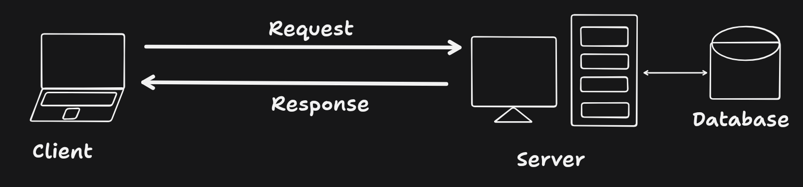
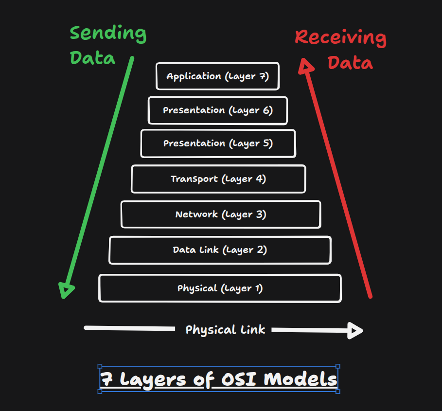
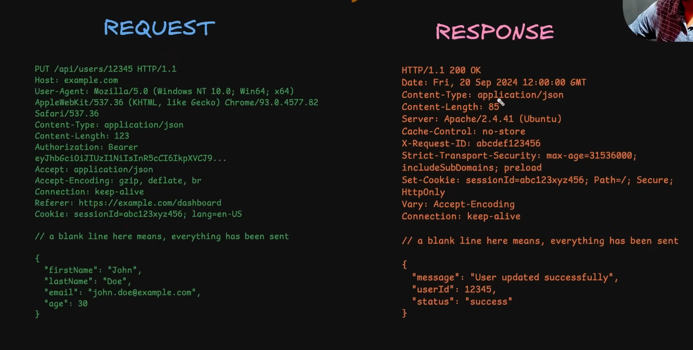

# HTTP Protocol

## What is HTTP Protocol?

- HTTP is used as one of the most common protocols for communication between clients and servers.
- HTTP follows stateless communication protocol in client-server model.

## HTTP is stateless protocol

- HTTP is stateless protocol meaning it does not maintain any data of previous request and responses between the client which makes every request and response independent of each other
- While making an HTTP request, it must contain a URL and HTTP method, and may optionally contain headers, query parameters, and a body
- As every request is independent it should contain all the data required to process the request
- In most cases, server handling HTTP request are also stateless and they do not maintain any data of previous request and responses between the client
- For example in case of CRUD application every request made to server will contain information about intent, data and auth info with every request
- Benefits of stateless protocol are:
  1. Simplicity of implementation.
  2. Scalability as multiple servers can be used to handle requests and in case of failure of one server, other servers can handle the request
- State management is don through cookies and session management
- HTTP and HTTPS are same protocol but HTTP is used for data transfer over network and HTTPS is used for secure data transfer over network making it reliable and secure
- Through out years HTTP has been upgraded version on version redefining how communication is done between client and server and HTTP/1, HTTP/2, and HTTP/3 are the major versions of HTTP protocol.

## Client-Server Model

- The client-server model consists of two or more machines connected over a network, where the client sends requests and the server processes those requests.
- The server hosts resources or services, accepts client requests, processes the provided input, and sends the response back to the requesting client.



## Web Protocols

### 1. SSL

- SSL (Secure Sockets Layer) is a original cryptographic protocol that provides secure communication over a computer network.
- It was designed so the attacker can't read the data being sent between the client and server without the server's private key.
- Currently, SSL is outdated and is being replaced by TLS (Transport Layer Security).

#### 2. TLS

- TLS (Transport Layer Security) is a newer cryptographic protocol that provides secure communication over a computer network.
- It is based on SSL, but it uses a more modern and secure protocol which encrypts the data being sent between the client and server.
- TLS uses a certificate to authenticate the server and encrypt the data being sent between the client and server.
- It has constantly evolving features and improvements, and its current version is TLS 1.X

#### 3. HTTPS

- HTTPS (Hypertext Transfer Protocol Secure) is a secure version of HTTP that uses SSL/TLS to encrypt the data being sent between the client and server.
- It is the most commonly used protocol for secure web browsing.

## HTTP Version Evolution

- HTTP/0.9:
  - The earliest version; supported only simple GET requests and HTML responses.
  - Disadvantage: Very limited features; no headers, status codes, or support for different content types.
- HTTP/1.0:
  - Added headers, status codes, and support for different content types.
  - Disadvantage: Usually opened a new TCP connection for each request, increasing overhead and slowing performance.
- HTTP/1.1:
  - Introduced persistent connections, allowing multiple requests to use the same TCP connection, along with caching and chunked transfer encoding.
  - Disadvantage: Can suffer from head-of-line blocking, and multiple connections may be needed for better performance.
- HTTP/2:
  - Introduced multiplexing, allowing multiple requests and responses concurrently over one TCP connection, along with binary framing and header compression.
  - Disadvantage: Still uses TCP, so packet loss can cause head-of-line blocking at the connection level.
- HTTP/3:
  - Uses QUIC over UDP instead of TCP, reducing transport-level head-of-line blocking and improving performance on unreliable networks.
  - Disadvantage: More complex and requires support for QUIC/HTTP/3.

## OSI Model

- HTTP uses the OSI model for network communication and data transfer.
- Physical Layer: Transmits raw bits through cables, radio, or other physical media.
- Data Link Layer: Transfers data between directly connected devices and handles error detection.
- Network Layer: Determines the best path and routes packets between networks.
- Transport Layer: Provides reliable data delivery and controls data flow between devices.
- Session Layer: Establishes, manages, and terminates communication sessions.
- Presentation Layer: Handles data formatting, encryption/decryption, and compression.
- Application Layer: Provides network services directly to applications such as web browsers and email clients.

  

> Key Takeaways: HTTP is underlying technology for sending and receiving data between client and server.

## HTTP Messages

These 2 types of messages are used to communicate between client and server.

1. Request Message: Sent from client to server to request a specific resource or service.

2. Response Message: Sent from server to client to provide a response to the request message.

   

### HTTP Message Structure and Components

- Headers:
  - key-value pairs that provide additional information about the message.

  - Headers are added separately so they can read and understand message metadata without revealing the actual data being sent. Just like the info on envelope of a letter.

  - Types of headers:
    1. Request headers: contain information about the request itself, such as the HTTP method, URL, and headers.
       - User-Agent: is the type of security that the server can send
       - Authorization: is the authentication token
       - Cookie: is the authentication token
       - Accept: is the type of data that the server can send
       - HTTP Method / Verb: is a keyword that denotes the intent of the method
       - Resource URL: is the address + endpoint where the request is made
       - HTTP Version: denotes the version of the HTTP protocol
       - Host: is the domain of the request source (mostly the front-end domain)
       - Accept-Encoding: is the type of data compression that the server can send
       - Referrer: is the previous page that the user was on
       - X-Requested-With: is the type of request that the server can send

    2. General headers: contain information about the message itself, such as the content type, length, and encoding.
       - Date: is the date and time of the request
       - Cache-Control: is the type of caching that the server can send
       - Connection: is the type of connection that the server can send

    3. Response headers: contain information about the response itself, such as the status code, headers, and content.
       - Content-Type: is the type of data being sent
       - Content-length: is the length of data being sent
       - Content-Encoding: is the type of data compression that the server can send
       - Etag: is the type of data compression that the server can send
       - Server: is the server that is processing the request

    4. Security headers: contain information about the security of the message, such as the security policy, SSL/TLS, and HSTS.
       - Strict-Transport-Security: is the type of security that the server can send
       - Content-Security-Policy: is the type of security that the server can send
       - X-Frame-Options: is the type of security that the server can send
       - X-XSS-Protection: is the type of security that the server can send
       - X-Content-Type-Options: is the type of security that the server can send
       - Set-Cookie: is the type of security that the server can send
       - includeSubDomains: is the type of security that the server can send
       - Path: is the type of security that the server can send

  - Headers are highly extensible and can be added by the server or client depending on the needs of the application with changing underlying protocol.

  - Custom headers can be added to the message By Convention the start with X- and are prefixed with the name of the application that created the header.

  - Request Headers are like remote controls that can instruct, customize, or modify the behavior of the server also they they can be used to authenticate the client.

- HTTP Method / Verb:
  - It is a keyword the denote the intent of method

  - Type of requests
    1. GET: Requests to fetch data from the server.
    2. DELETE: Request to deletes data from the server.
    3. POST: Request to create data on the server.
    4. PUT: Request to update data on the server. Resource is completely replaced by the sent data.
    5. PATCH: Request to update data on the server. Resource is partially replaced by the sent data.
    6. OPTIONS: Request to get the list of available methods on the server. This used by CORS to check which request are allowed to made by client for the browser makes a pre-flight request and get the list of allowed methods.

    > while updating data prefer PATCH over PUT unless specific reasons

  - `GET`, `PUT`, `DELETE` are the idempotent methods, which means that the method can be called multiple times without changing the state of the server and the result will be the same. On the other hand, `POST` and `PATCH` are not idempotent, which means that calling the same method multiple times can change the state of the server.

- Resource URL : is address + endpoint where the request is made

- HTTP version : denote version http protocol

- Host: domain of request source (mostly the front-end domain)

- Accept-Encoding: is the type of data compression that the server can send

- Referrer: is the previous page that the user was on

- Server: is the server that is processing the request

- X-Requested-With: is the type of request that the server can send

- includeSubDomains: is the type of security that the server can send

- Path: is the type of security that the server can send

- Blank line: is used to separate the headers from the body of the message

- Body: is the actual data being sent. It can be in JSON, XML, HTML, or any other format (Recommended to be in JSON)

## CORS

- Cross-Origin Resource Sharing (CORS) is a mechanism that allows or restricts the code from server run on client machine
- In a browser environment, a webpage can only call apis from the same origin. If downloaded JS code tries to call another domain's api, it will be blocked by the browser. That is CORS policy.
- CORS mechanism work with different flows of request

### 1. Simple request flow

- A simple request is a cross-origin request that the browser sends directly, without a CORS preflight OPTIONS request
- Simple request has method `GET`, `HEAD`, `POST`

#### Flow of simple request

1. The user makes the request.
2. Before sending, the browser adds an `Origin` header that identifies the requesting site.
3. The request reaches the server and is processed.
   4Simple request flow:. The server adds `Access-Control-Allow-Origin` to the response if the origin is allowed.
4. The browser checks that header on the response. If it is valid, JavaScript can read the response. If it is missing or invalid, the browser blocks access and logs a CORS error. The server has already processed the request by this point.

#### Example of simple request

1. When running the front-end on `https://www.front-end.com` and the back-end API on `https://www.back-end.com` these are different origins because the hosts are different.
2. Now the front-end makes a request to the back-end API `fetch("https://www.back-end.com/api/users");` in which browser sees front-end origin as `https://www.front-end.com` and back-end Origin `https://www.back-end.com`. Request sent by browser is like this

   ```text
     GET /api/users HTTP/1.1
     Host: www.back-end.com
     Origin: https://www.front-end.com

   ```

3. The back-end receives the request, process it and responds with a CORS header attached:

   ```text
   HTTP/1.1 200 OK
   Access-Control-Allow-Origin: https://www.front-end.com
   Content-Type: application/json

   Body
   {
     "users": [
       { "id": 1, "name": "John" },
       { "id": 2, "name": "Raya" },
     ]
   }

   ```

4. The browser checks `Access-Control-Allow-Origin` of response. If the response does not have a matching `Access-Control-Allow-Origin`, the browser restricts the frontend JavaScript from accessing the response.

### 2. Pre-flight request flow

- Used to check whether the server allows a cross-origin request before the actual request is sent.
- Non-simple request can have one of the following
  1. Pre-flight request has method `PUT` and `DELETE`
  2. Request has custom headers like `Authorization`
  3. Request has a content-type other than `application/x-www-form-urlencoded`, or `multipart/form-data` or `text/plain`

#### Flow of pre-flight request

1. The user makes the request.
2. Before sending, the browser checks whether the request is “non-simple”. If so, it sends a preflight `OPTIONS` request first.
3. The preflight includes `Origin`, `Access-Control-Request-Method`, and `Access-Control-Request-Headers`.
4. The server checks the CORS policy and responds with a success status and headers such as `Access-Control-Allow-Origin`, `Access-Control-Allow-Methods`,`Access-Control-Allow-Headers` and `Access-Control-Max-Age` if the request is allowed.
   - `Access-Control-Allow-Origin`: is the allowed domain that can access the resource and contains a string url or \* if all origins are allowed
   - `Access-Control-Allow-Methods`: it the allowed methods that can be used to access the resource and contains a string of methods name separated by comma or \* if all method are allowed
   - `Access-Control-Allow-Headers`: is the allowed headers that can be used to access the resource and contains a string of headers name separated by comma or \* if all headers are allowed
   - `Access-Control-Max-Age`: is the time in seconds that the preflight result is valid. with in this time browser will not send preflight request for same URL
5. The browser checks the preflight response. If it is valid, it sends the actual request and contains a numeric string

#### Example of pre-flight request

1. The browser's JavaScript at `https://app.example.com` calls `fetch("https://api.example.com/api/items", { method: "POST", headers: { "Content-Type": "application/json", "Authorization": "Bearer ..." } })`.
2. Because the origin differs from the target and the request uses a non-simple method or headers, the browser stops the real request and sends a preflight `OPTIONS` request first:

   ```text
   OPTIONS /api/items HTTP/1.1
   Host: api.example.com
   Origin: https://app.example.com
   Access-Control-Request-Method: PUT
   Access-Control-Request-Headers: Content-Type, Authorization
   ```

   No request body is sent.

3. The server checks the origin, method, and headers, then replies:

   ```text
   HTTP/1.1 204 No Content
   Access-Control-Allow-Origin: https://app.example.com
   Access-Control-Allow-Methods: POST, DELETE
   Access-Control-Allow-Headers: Content-Type, Authorization
   Access-Control-Max-Age: 86400
   ```

4. The browser checks the response. If the origin, method, and headers are all allowed, it proceeds. If not, it blocks the request and logs a CORS error, and the JavaScript never gets a response.
5. The browser sends the actual `POST /api/items` request with the original body and headers.
6. The server processes the request and returns its response with `Access-Control-Allow-Origin` set, so the browser lets the JavaScript read it.
7. Within the `Access-Control-Max-Age` window (here 86400 seconds, or 24 hours), the browser reuses the preflight result and skips step 2 for later requests to the same URL.

> In most of projects,data is sent and received in JSON format so most of requests consider as pre-flight request

## Response Code

- is a 3 digit number which can categorized based on their first digit
- based on response code we can understand the status of the request without looking at the response body which be empty or contains data in different format
- standardization of response code brings consistency in the way we handle the response regardless of the server implementation,technology or programming language

### 1xx Informational

| Status | Status Message      | Usage                                           |
| ------ | ------------------- | ----------------------------------------------- |
| 100    | Continue            | Server accepts headers; client sends the body.  |
| 101    | Switching Protocols | Upgrade to another protocol, such as WebSocket. |

### 2xx Success

| Status | Status Message | Usage                                         |
| ------ | -------------- | --------------------------------------------- |
| 200    | OK             | Request succeeded and returns data.           |
| 201    | Created        | New resource created, such as after a POST.   |
| 202    | Accepted       | Accepted for processing, not yet finished.    |
| 204    | No Content     | Success with no body, such as after a DELETE. |

### 3xx Redirection

| Status | Status Message    | Usage                                      |
| ------ | ----------------- | ------------------------------------------ |
| 301    | Moved Permanently | URL has permanently changed; update links. |
| 302    | Found             | Temporarily at a different URL.            |
| 304    | Not Modified      | Cached copy is still valid; no body sent.  |

### 4xx Client Error

| Status | Status Message       | Usage                                              |
| ------ | -------------------- | -------------------------------------------------- |
| 400    | Bad Request          | Malformed request or failed validation.            |
| 401    | Unauthorized         | Missing or invalid authentication.                 |
| 403    | Forbidden            | Authenticated but not allowed to access.           |
| 404    | Not Found            | Resource or endpoint doesn't exist.                |
| 405    | Method Not Allowed   | Endpoint doesn't support this HTTP method.         |
| 409    | Conflict             | Conflicts with current state, such as a duplicate. |
| 422    | Unprocessable Entity | Well-formed but fails semantic validation.         |
| 429    | Too Many Requests    | Rate limit exceeded; retry later.                  |

### 5xx Server Error

| Status | Status Message        | Usage                                      |
| ------ | --------------------- | ------------------------------------------ |
| 500    | Internal Server Error | Unhandled server error.                    |
| 501    | Not Implemented       | Server doesn't support this functionality. |
| 502    | Bad Gateway           | Invalid response from upstream server.     |
| 503    | Service Unavailable   | Overloaded or down for maintenance.        |
| 504    | Gateway Timeout       | Upstream server didn't respond in time.    |

## HTTP Caching

- HTTP caching is a mechanism that allows a client to reuse the previously sent response instead of receiving a new response from the server which reduces bandwidth usage, server load, and improves, response times and performance
- When ever a request is processed its response is stored on server in hashed format and when next similar request generated exact same response hash server instructs the frontend to use cached versions of the response
- HTTP caching is done with the help of `ETag` and `Last-Modified` headers

### HTTP Caching Flow

1. The client sends the first request, and the server processes it and generates a response.
2. Before sending the response, the server stores it in the cache and adds these headers: `ETag` (a hash of the response), `Last-Modified` (when the response was generated), and `Cache-Control` (with a max-age or expiry time).
3. The client sends another request, and the server processes it and generates a response hash.
4. The server compares the new hash with the cached hash. If they match, the client is instructed to use the cached response.
5. If the cached version can be used, the server sends `304 Not Modified` with no body. Otherwise, it sends `200 OK` with the new response and updated `ETag`, `Last-Modified`, and `Cache-Control` headers.

## Content Negotiation

- This decides how the server should respond to a request based on the client's preferences for type, encoding, language, and so on.
- The client states its preferences in request headers, and the server picks the best matching representation.
- Following are the main types of content negotiation:
  1. Type: `Accept` header, such as `text/html` or `application/json`
  2. Encoding: `Accept-Encoding` header, such as `gzip` `zstd`,`br` or `deflate`
  3. Language: `Accept-Language` header, such as `en-US` or `fr-FR`
  4. Charset: `Accept-Charset` header, such as `utf-8` or `iso-8859-1`

- Each header can include quality values (`q`) to rank preferences, for example `Accept: application/json;q=0.9, text/html;q=0.8`.
- The server responds with `Content-Type`, `Content-Encoding`, `Content-Language`, and `Vary` headers so caches know which variant was sent.
- If the server cannot match any preference, it uses a fallback representation or returns `406 Not Acceptable`.

## HTTP Content Compression

- Compression reduces the size of a response body before it is sent, which lowers bandwidth use and speeds up page loads.
- Compression is most effective on text-based content like HTML, CSS, JavaScript, and JSON. Images and other already-compressed formats gain little.
- The `Vary: Accept-Encoding` header tells caches to store separate versions for different encodings.

### Flow of HTTP Content Compression

1. The client sends a request with supported algorithms in the `Accept-Encoding` header, for example `gzip, deflate, br`.
2. The server compresses the body and labels algorithms with a `Content-Encoding` header, such as `gzip` or `br` (Brotli).
3. The client decompresses the body using the declared encoding.

## Persistent Connections and Keep-Alive

- In early HTTP versions like HTTP/1.0, the TCP connection was closed after each request. This meant the client had to reconnect for every request, which wasted bandwidth and server resources.
- HTTP/1.1 made connections persistent by default, so multiple requests can be sent over a single connection. Earlier HTTP/1.0 clients could opt in with the `Connection: keep-alive` header.
- HTTP/2 goes further by multiplexing many concurrent requests over a single connection, rather than handling them one after another.
- Usually, you don't need to set the `Connection` header manually, because the default behavior works well for most cases.

## Handling Requests and Responses with larger payloads

### 1. Multi-part requests

- Mostly use for sending files to server
- Media files like documents, images, videos, and audio files can be very large and sending them over Http can be slow.
- Multi-part requests allow sending larger files in smaller chunks, which reduces the overhead of sending the entire file at once.

#### Flow of sending a multi-part requests

1. In the front end user sends request with attached file
2. code picks up the file and create a multi-part request which has a headers like `Content-Type: multipart/form-data; boundary=xyz` and `Content-Length` header
   - `content-type` header is used to specify the type of the request body
     `content-length` header is used to specify the length of the request body
   - `boundary` is used to separate different parts of the request body actually the boundary is a string that is used to separate the different parts of the request body like delimiter. starting of first part of the request body and ending of last part is `--boundary--` so that the server can identify and combine the parts
3. After receiving the ending delimiter the server receives the entire request body and send an acknowledgement to the client in form response

### 2. Streaming responses

- Mostly use for receiving files from server
- Streaming responses allow the server to send a response body in chunks

##### Flow of streaming responses

1. Client sends a request to the server
2. Server receives the request, process it and starts sending the response
3. Server sends the first and subsequent parts of the response are received by user with headers like `Content-Type : text/event-stream`,`connection: keep-alive` and `Transfer-Encoding: chunked`
4. last part of the response is received with headers like `Content-Type : text/event-stream`,`connection: close` and `Transfer-Encoding: chunked` which means the server has finished sending the response
