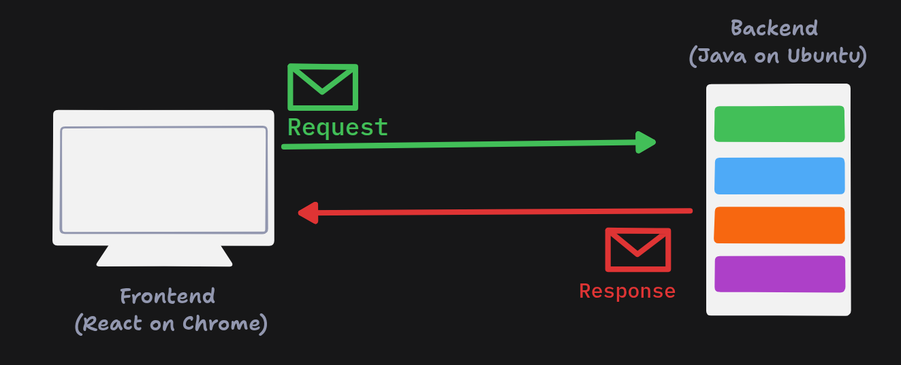

# Serialization & Deserialization

## Problem Statement

- Different technologies use different languages, libraries, and frameworks to build applications. Each one serves a different purpose, has its own set of features, and works in a completely different way internally.

- These systems need to communicate with each other and share data.

- The challenge is how to unify data sharing between these systems so they can work together.

## Solution

- To solve this, we need a set of rules and standards for sending and receiving data. There are many such standards, and the most widely used one is JSON.

- Serialization is the process of converting data from one format to another, for example, converting data from a programming language into JSON.

- Deserialization is the reverse process: converting data back into its original format, for example, converting JSON back into objects in a programming language.

- Apart from JSON, there are other formats such as XML, CSV, YAML, and so on.

## Types of Serialization and Deserialization

1. Text-based serialization and deserialization
2. Binary format serialization and deserialization (Protocol Buffers, Avro, Thrift, etc.)
3. Object serialization and deserialization
4. Graph serialization and deserialization

## JSON

- JSON stands for JavaScript Object Notation. It is a lightweight data-interchange format.

- It is easy for humans to read and write, and easy for machines to parse and generate.

- JSON is a text format that is completely language-independent. It uses conventions familiar to programmers of the C-family of languages, including C, C++, C#, Java, JavaScript, Perl, Python, and many others.

- JSON has these built-in structures:
  - Objects: a collection of key-value pairs
  - Arrays: an ordered list of values

- JSON is not only used for data exchange. It is also used for configuration files, logs, and more.

- JSON syntax is simple and readable:
  1. A JSON document is enclosed in curly braces `{}`.

  2. Keys are strings enclosed in double quotes `""`. Values can be any type of data:
     1. A single value is enclosed in double quotes `""` if it is a string.
     2. Objects are enclosed in curly braces `{}`, and each key-value pair is separated by a comma `,`.
     3. Arrays are enclosed in square brackets `[]`, and each value is separated by a comma `,`.

  3. By convention, JSON files are kept small enough to load in one go, typically well under 100 MB. Many tools and teams aim for a few MB, since larger files get slow to parse and hard to edit by hand. For larger datasets, people usually switch to formats like JSON Lines (NDJSON), where each line is a separate JSON object, so tools can stream the data one record at a time.
