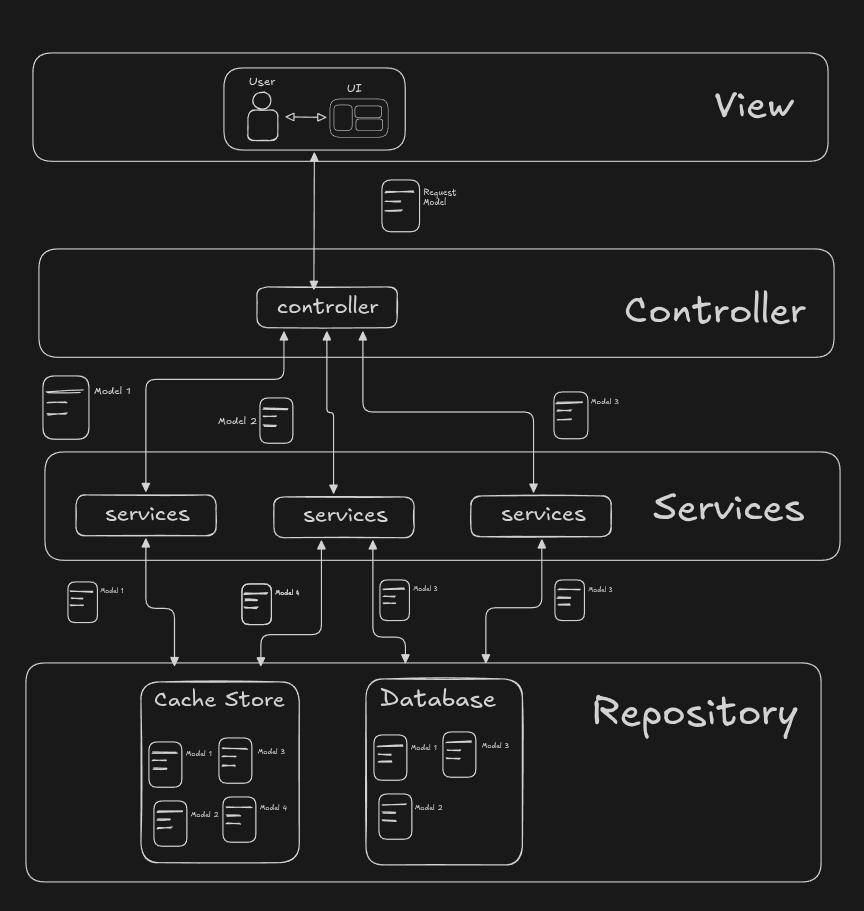

# 05 Validations & Transformations

## Flow of MVC architecture for APIs

1. User using the View (Frontend Application UI) sends request to the Controller (Backend API).
2. Controller receives the request, deserializes data to compatible format and validates the data and convert it to model object, it also transforms the data if needed.
3. Controller calls service and passes the model object to the service.
4. Service performs the business logic and calls repository to save the data to database with model that is compatible with database.
5. Repository saves the data to database and returns the result to the service which is also a model that service understands.
6. Service returns the result to the controller with cleaned data model
7. Controller converts the model to serialized data and sends the response to the user with appropriate status code.

## What is Validations ?

- Validation is process of verifying that the data is in correct format and can be used for further processing.

- The idea behind validation and transformation is all the input data received in the form of query parameters, body parameters, path parameters, headers, cookies, etc should be validated and transformed before using it for further processing so that its in correct format and can be directly used in business logic.

- Example: user input value is is string of numbers only, is start with 7,8,9 and can be valid phone number.

- Flow of validations:
  1. User request data received by controller
  2. Request is routed to appropriate controller
  3. Controller validates the data
     A. if validation fails, controller responds with appropriate error message.
     B. if validation passes, controller calls service and repository to perform the business logic and responds with the result.
  4. Service tries to perform the business logic and saves the data to database.
     A. if something goes wrong, controller responds with appropriate error message.
     B. if everything goes well, controller responds with the result.
  5. Controller again validates and transforms the data before sending the response to the user.
  6. User receives the response.

- Type of validations:
  1. Syntactical validations where data follows the format and rules.
  2. Semantical validations where data is valid and meaningful.
  3. Type validations where data is of expected type.

- Most common validations are:
  1. Required fields in user input data like name, email, phone, dob number are required.
  2. Data type validations like name email, phone number are of type string and dob is of type date.
  3. Data length / size validations like name is 50 characters long, email is 100 characters long.
  4. Data format and pattern validations like email and phone number is in valid format.
  5. Data range validations like dob is between 01-01-1900 to 31-12-2099.
  6. Valid data values like given username is valid and available.

- Validations are responded with 4XX error code which indicate the client error.

## What is Transformations ?

- Transformation is process of converting the input data into valid / expected format so that it can be used for further processing directly.

- Example: user input is date which need to in format dd/mm/yyyy, so we need to convert the date into dd/mm/yyyy from dd-mm-yyyy format or other format.

- Generally transformations are performed after the request validation to create the data needed before the business logic and response creation to sanitize the response.

## Why and where to use Validations and Transformations ?

- In any API based backend services, validations and transformations are written in Controllers

- Controller are responsible for receiving the request data from the client and sending back appropriate response to the client.

- Controllers validate and transform the data so that service and repository can directly use the pre-validated and transformed data and while responding no data goes outside unintentionally.

- Before starting any business logic, controllers validate and transform the data in expected format.

- Validations and Transformations code and logics are tied together so everything related stays in one place and easy to maintain and in case of modification or addition changes are easy to be made and debugging is easy in case of error. Validations and Transformations are written in Controllers so that they are reusable and can be used in multiple controllers.

- Validations and Transformations errors are handled in Controllers and return descriptive error messages to client so that client can understand the error and fix it.

- Validations and Transformations error messages are logged in the application logs so that they can be monitored and fixed in case of error and should not reveal any sensitive information like passwords, tokens, etc or internal server information.

## Frontend Validations and Transformations vs Backend Validations and Transformations

- Frontend and backend validations and transformations are different and should always be handled separately.

- Frontend validations and transformations are done for user experience, and to make things faster and easier for the user before sending the request to the backend.

- Backend validations and transformations are done for security and data integrity, which prevents the invalid and errors data to used in the applications business logic and getting saved to the database.

- In some cases, frontend is not there or loosely do validations and transformations, in that case backend will get data is buggy and invalid. So backend should always strongly validate and transform the data before using it in the business logic.

- Validations and transformations transformations logics are lightweight and should not be too complex, so even if they are repeated at multiple stages it does not hamper the performance heavily.
