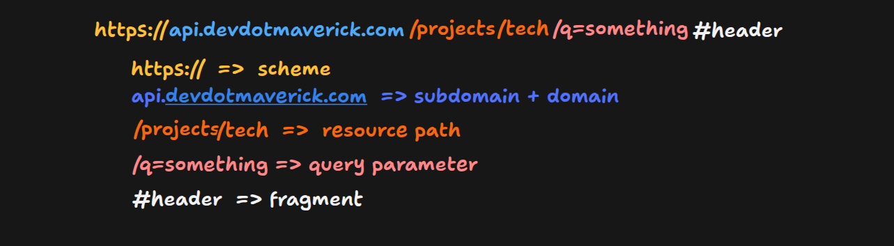

# REST API

## API Technologies in Modern Backend Systems

- In modern backend systems, APIs are used for communication between different parts of the system, such as frontend and backend, microservices, and other systems.

- APIs can be implemented using different technologies, depending on the requirements and the team's preferences.

- Some common API technologies include:
  1. REST: The default style for public and general-purpose APIs, using HTTP methods and resource URLs.
  2. GraphQL: Clients request exactly the fields they need from a single endpoint. Common in frontend-heavy products.
  3. gRPC: A high-performance RPC framework using Protocol Buffers and HTTP/2. Widely used for internal microservice communication.
  4. WebSockets: A persistent, two-way connection for real-time features such as chat, notifications, and multiplayer apps.
  5. Server-Sent Events (SSE): A one-way stream from server to client over HTTP. Commonly used for streaming LLM/AI responses.
  6. tRPC: Lets TypeScript clients call server functions directly with end-to-end type safety. Popular in full-stack TypeScript projects.
  7. Webhooks: The server sends an HTTP request to a registered URL when an event occurs. Standard for third-party event notifications (for example, Stripe, GitHub).
  8. Kafka / RabbitMQ: Message queues and event streaming for asynchronous, event-driven backend systems.

- The most commonly used API technologies are REST and GraphQL.

- Advantage of standardized API design is it reduces confusion and trial and error when learning how to use a server's API.

## REST API Standardization

- REST is a set of architectural constraints and design principles for creating web services.
- It is a widely adopted standard for building APIs and the most commonly used API technology in modern backend systems.
- Applying these standards removes ambiguity and inconsistencies in API design, making APIs easier to build and maintain.

## History of REST

- In 1989–1990, Tim Berners-Lee started the "World Wide Web" project to share information and resources on the internet.

- Within a year or two, he created technologies such as:
  1. URIs (Uniform Resource Identifiers) to identify resources on the web.
  2. HTTP (Hypertext Transfer Protocol) to send requests and receive responses.
  3. HTML (Hypertext Markup Language) to structure the content of web pages.
  4. Web servers to serve the content.
  5. Web browsers to access the content.
  6. WYSIWYG (What You See Is What You Get) editors to create and edit web pages.

- Most of these technologies are still in use today.

- As the number of users grew enormously, the WWW was at risk of breaking under the scale, so its architecture needed to be formalized.

- Roy Fielding, a co-founder of the Apache HTTP Server, worked on the HTTP and URI specifications and defined a set of architectural constraints for web services in his 2000 doctoral dissertation, which introduced REST (Representational State Transfer).

- Principles of REST:
  1. Client-server separation
  2. Uniform interface, which makes component communication easy
  3. Layered system
  4. Cacheable responses
  5. Statelessness
  6. Code on demand (optional)

## REST

- Representational: Resources are represented in a specific format, such as JSON or XML, based on what the client requests.
- State: The current condition of a resource in the system, which can be shared between server and client.
- Transfer: The movement of a resource's representation from one system to another.

### Parts of a URL

- Above is the typical URL structure for a REST API.
- Syntax: `scheme://domain[:port]/path-to-resource?query-string#fragment`
  - Scheme: The protocol used to access the resource, such as `http`, `https`, or `ftp`.
  - Domain: The domain name of the server, such as `www.example.com`, which maps to an IP address and port, or the IP address and port can be used directly.
  - Path: The resource path, in a hierarchical structure separated by slashes.
  - Query: A string of key-value pairs appended to the URL after a question mark (`?`).
  - Fragment: A string appended to the URL after a hash (`#`), which points to a specific section of the page.
- The industry standard for REST API URLs is `scheme://api.domain.com/version/name-of-resource?query-string#fragment`.
- Rules for creating API URLs:
  1. Use plural nouns for resource names, such as `users` instead of `user`.
  2. Keep the plural form even when accessing a single resource, such as `/users/1`.
  3. Don't use spaces in the URL. When creating a slug, use hyphens instead of spaces.
  4. Make the URL readable, easy to remember, and lowercase.

### Idempotency

- Idempotency means that calling an API multiple times with the same input has the same effect on the system as calling it once.
- For example, fetching the user with id 1 returns the same user object every time it is called with the same id, or an error/null if the user doesn't exist.
- Idempotent methods:
  - GET: Returns the same result when called again with the same parameters.
  - PUT: Overwrites the same resource with the same values.
  - Patch: Updates the resource with the same values.
  - DELETE: Deletes the resource; repeating the call leaves the system in the same state.
- Non-idempotent methods:
  - POST: Creates a new resource each time it is called.

### PUT vs PATCH

- PUT updates a resource by replacing the entire resource with the new one.
- PATCH updates only the properties passed in the request body.
- When an API is used by multiple clients, use PATCH cautiously to avoid conflicts.

### Non-CRUD APIs

- When an API is not performing any create, read, update, or delete operations, it is called a non-CRUD API. These non-CRUD task are called actions
- All the non-CRUD APIs are sent with HTTP verb `POST`
- Example of non-CRUD APIs: sending a message in chat application or sending an email where server checks who is the user sending and receiving the email, validate the details and send the email

### API Design Workflow

1. Create a UI prototype and wire-frames. They show how users will interact with the system and what data to expect from them. They also let the frontend and backend be built together, and the database models can be formed and locked down.

2. Use the entities from the UI prototype and wire-frames to create the database schema.

3. Identify the actions and their flows, and create an API endpoint for each action.

4. Use an API tool like Postman to create mock API endpoints. In the mocks, decide the method, URL, path, parameters, headers, request and response bodies, and the success and error codes.

5. Pagination and filtering
   - Define a pagination and filtering strategy for endpoints that return a list of data.
   - Pagination and filtering improve API performance in terms of response time and data transfer.
   - Accept the following parameters in the request to control pagination and filtering:
     1. `page`: current page number (default: 1)
     2. `pageLimit`: number of items per page (default: 10)
     3. `sortBy`: field name to sort by (default: `createdAt`)
     4. `sortOrder`: ascending or descending order (default: ascending)
     5. `filterField`: field name to filter by (default: none)
     6. `filterValue`: value to filter by (default: none)
   - Add pagination and filtering properties to the response schema, such as:
     1. `page`: current page number
     2. `pageSize`: number of items per page
     3. `totalCount`: total number of items
     4. `totalPages`: total number of pages
     5. `sortBy`: field name sorted by
     6. `sortOrder`: ascending or descending order

6. CRUD on a resource using a single endpoint
   - When creating endpoints for CRUD operations on a single resource, use the same endpoint path for all operations and differentiate them by HTTP method:
     1. GET `baseUrl/v1/resources/{id}`: Retrieves the resource with the specified ID.
     2. POST `baseUrl/v1/resources`: Creates a new resource.
     3. PUT `baseUrl/v1/resources/{id}`: Replaces the resource with the specified ID.
     4. PATCH `baseUrl/v1/resources/{id}`: Partially updates the resource with the specified ID.
     5. DELETE `baseUrl/v1/resources/{id}`: Deletes the resource with the specified ID.
     6. DELETE `baseUrl/v1/resources`: Deletes all resources.
   - For action endpoints, use `POST` and follow the same API standards as other REST calls.

7. Choose the right HTTP response code.
   - Status codes are grouped by class:
     1. `1xx` (informational): the request was received and the server is continuing to process it.
     2. `2xx` (success): the request was processed successfully.
     3. `3xx` (redirection): the client must take further action.
     4. `4xx` (client error): the request is invalid.
     5. `5xx` (server error): the server failed to process a valid request.

### Best Practices for Building REST APIs

1. Use exactly the same field names for the same resource's fields in all request and response payloads.
2. Use plural names for resources.
3. Use the right HTTP method for each operation and the correct status code for each response.
4. Use interactive API documentation built with tools like Swagger.
5. Make the API intuitive, consistent, and easy to use.
6. Provide default values for optional parameters.
7. Avoid abbreviations.
8. Use nouns, not verbs, in resource URLs; the HTTP method describes the action.
9. Version the API in the URL, such as `/v1/resources`.
10. Return errors in a consistent format across all endpoints.
11. Use HTTPS for all endpoints.
