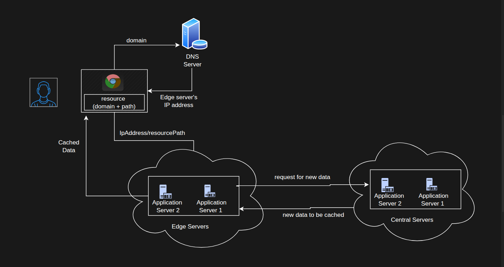
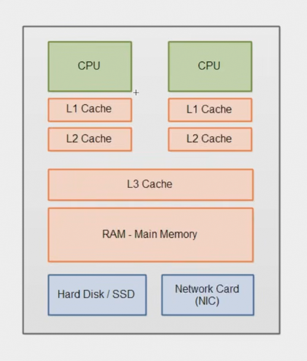

# Caching

- Caching is a technique used to improve the performance of applications by storing frequently accessed data and reducing effort of fetching data from database by placing it in faster storage options so that it can be retrieved quickly.

- Subset of data is stored in primary memory or something that is fast to access, Data to be cached is decided depending on how frequently it is accessed.

- Examples of data that can be cached are:
  1. Google search results:
     - When you search for something on Google, instead searching the entire web, the search results are cached somewhere for a period of time. In that timeframe, anyone who searches for same keywords will get the same results without having to wait for the server to respond.
     - If the searching algorithm does not find any cached results, it will query the server, which will compute the results and store them in cache for future use.

  2. Netflix content delivery:
     - While streaming a video, Netflix has compute different resolutions of the video, and depending on user preferences and network speed, it will choose the best resolution to stream. During this process, it has to also look for minimum server load, which is the server that has the least amount of users connected to it and no buffering
     - The central server which has all the movies and TV-shows is connected to edge servers. A edge server is server that is subset copy of the central server which contains only those moves and TV-shows that are available in the region / very popular in that region. With this implementation, user connects to the edge server closer to them and gets the best quality of the video with much of latency and buffering and this also reduces the load on the central server distributing the content.

  3. Vercel content delivery:
     - Similar to Netflix, Vercel also has a similar architecture where it has a central server and edge servers.
     - The difference is instead of streaming video it serve the HTML, CSS, JS, Images, etc to the user from its cache.

  4. Social media trends:
     - Content on social media such as Twitter, Facebook, Instagram, etc is generated so fast and it consumption is high that it is not possible to store it in a database and serve it to the user, So instead companies constantly run algorithms to generate trends and keep track of media that can go viral. They only store those viral and trending media in their cache and rest is served from their database or some other source.
     - After some specific time period, trends are re-computed and new trends are added to the cache.

- Observe that,
  - Anything that used very frequently and caused a heavy computation is a good candidate for caching.
  - but content / data that is generated dynamically can't cached like LLM responses wherebr every query generates a new response.
  - We simply can't put everything that is used frequently in cache.

- In context of backend engineering, caching can be divided into three categories:
  1. Network Caching
  2. Hardware Caching
  3. Software Caching

## Network Caching

### 1. CDN Caching

- Content delivery network (CDN) is a network of servers that are distributed across the globe and are used to deliver content to users.

- They cache content that is geographically close to the user with help edge servers.

## Flow of CDN

1. User enters a URL (image, video, or web page) in the browser.
   - If the IP address is already present in the browser or OS DNS cache, it is reused.
   - Otherwise, a DNS query is sent to resolve the domain name, potentially returning the IP address of a nearby CDN edge server. Some CDNs use other routing mechanisms.

2. The request for the resource is sent to an edge server in a POP (Point of Presence)
   - PoP is a physical location containing CDN infrastructure, including edge servers, networking equipment, and sometimes caching or routing systems.
   - A POP can contain multiple edge servers that handle requests for different domains and distribute incoming traffic to handle requests efficiently.
   - The CDN routes the request to a suitable POP based on the user's location and network conditions.

3. The edge server checks its cache for the requested content.
   - Cache hit: The content is found, so the edge server returns it directly to the user.
   - Cache miss: The edge server fetches the content from the origin server, may cache a copy, and then serves it to the user.
   - Cached content is kept according to its TTL (Time to Live).

   

### 2. DNS Caching

- DMS (Domain Name System) is a hierarchical naming system that translates domain names into IP addresses.
- It caches the IP addresses of the domain names, so that subsequent requests for the same domain name can be resolved quickly.

## Flow of DNS Caching

1. The user enters a URL, such as `https://example.com`, in the browser.
2. The browser checks its own DNS cache for the domain's IP address. If found, it reuses the cached IP address.
3. If the browser cache misses, the operating system checks its DNS cache. If found, it returns the cached IP address.
4. If both caches miss, a DNS query is sent to a recursive DNS resolver, often provided by an ISP or a public service like Google DNS.
5. The recursive resolver checks its cache. If there's a cache hit, it returns the cached IP address to the client.
6. If there's a cache miss, the recursive resolver queries a root name server.
7. The root name server returns the address of the appropriate Top Level Domain (TLD) name server, such as the one for `.com`.
8. The recursive resolver queries the TLD name server.
9. The TLD name server returns the address of the authoritative name server responsible for the domain.
10. The recursive resolver queries the author itative name server.
11. The authoritative name server returns the requested DNS record containing the IP address.
12. The recursive resolver caches the result according to its TTL (Time to Live) and returns the IP address to the client.
13. The browser or operating system may cache the DNS result according to its own caching rules. The browser can then connect to the server hosting the resource.

## Hardware caching

- The purpose of the CPU cache hierarchy is to reduce the time the CPU spends waiting for data from RAM or storage.
  - CPU: Executes instructions and performs computations.
  - L1 cache: Stores frequently or recently used data and instructions for extremely fast access.
  - L2 cache: Provides more storage than L1 but is slightly slower.
  - L3 cache: Provides a larger cache, often shared among multiple CPU cores.
  - RAM: Stores active programs and data but is slower than CPU caches.
  - Secondary storage: Stores data persistently but is much slower than RAM.

- Flow of Hardware Caching
  1. The CPU needs data or instructions to execute an operation.
  2. The CPU checks the L1, L2, and L3 caches in order; if all miss, it fetches the data from RAM.
  3. If the required data is not in RAM, the operating system loads it from secondary storage.
  4. The fetched data is stored in RAM and may be cached in the CPU caches for subsequent access.
     This hierarchy improves performance by keeping frequently needed data closer to the CPU.

- Example, arrays: when you traverse an array sequentially (1, 2, 3, 4, 5), the CPU uses predictive algorithms to load the whole memory block into L1/L2 cache. This is why sequential array access is fast.

### random access memory (RAM) vs Hard disk (HDD) vs SSD (SSD)

- RAM uses electrical signals to access any memory address with nearly constant access time. HDDs use mechanical moving parts to locate data, making them slower, while SSDs use flash memory with no moving parts, making them faster than HDDs but generally slower than RAM.
- Trade-off: RAM is fast, but has limited capacity and is volatile (data is lost when power is off). Secondary storage is slower, but has large capacity and is persistent, so RAM cannot replace disk storage. Each has its own use.

> Redis, Memcached, and AWS ElastiCache are popular in-memory caches that store and access all data in RAM for very fast reads and writes, while using secondary storage behind the scenes only for persistence (reloading data into RAM on start).

## 3. Software caching

- Software caching is done through a library or software that you interact with (e.g., node-redis in Node.js). It is not purely software, because it still uses hardware (RAM) underneath.
- Tools: Redis, Memcached, AWS ElastiCache (in the cloud). Valkey is the open source alternative to Redis.
- These are in-memory, key-value, NoSQL databases.
  - In-memory: data is stored in RAM, not on disk, so access is very fast.
  - Key-value: simple structure of a key and a value (string, number, list, JSON, etc.), with no strict schema, tables, or rows like SQL databases.
- Usage is simple: provide a key and value to store, provide the key to retrieve.

Caching strategies

1. Lazy caching (cache aside)
   - Data is cached only when someone actually requests it.
   - Client requests a resource and the server checks the cache.
   - Hit: if found, it returns it.
   - Miss: if not found, it fetches from the primary storage, stores it in the cache, then returns it to the client.
   - Used for read-heavy data that is rarely written (product details, user profiles).

2. Write through
   - On every create or update (POST, PUT, PATCH), update the database and the cache in the same API call.
   - Advantage: cache is always fresh and never serves old data.
   - Downside: write operations have more overhead.
   - Used when the cache must always have the latest data.

### Eviction policies

Eviction policies

- An eviction policy is the rule a cache uses to decide which data to remove when its memory is full, so that new data can be stored.

- They are used:
  - In-memory caches like Redis use RAM, which has limited capacity compared to disk.
  - A cache is only a subset of the primary storage, so it cannot hold everything.
  - When memory runs out, old or less useful data must be removed to make space for new, higher priority data.

#### Types of eviction policies

1. No eviction
   - When no eviction policy is set, the cache will not remove any data. Not recommended.
   - When the cache memory is full and you insert new data, you get an error that the memory is full.

2. LRU (least recently used)
   - LRU removes the key that hasn’t been used for the longest time when the cache is full, to make space for the new key.
   - works like a fixed length list where the most recently used key moves to the top, and when the cache is full, the key at the bottom (least recently used) is removed.
   - Example: keys 1, 2, 3 were accessed today and key 4 was accessed yesterday. When key 5 comes in and the cache is full, key 4 is removed and key 5 is stored.

3. LFU (least frequently used)
   - LFU removes the key that has been used the fewest times when the cache is full, to make space for the new key.
   - It works like a list sorted by usage count, where the most frequently used keys stay at the top and the least frequently used key sits at the bottom. When the cache is full, the bottom key is removed.
   - Example: Each key has a counter that increases on every access {key 1: 5, key 2: 10, key 3: 6, key 4: 23}. When key 5 arrives and the cache is full, key 1 is removed because it has the lowest count, and key 5 takes its place.

4. TTL based
   - Each key can have a TTL (time to live) set in Redis, and once the time runs out, the key is removed automatically.
   - When a new key comes in and the cache is full, the key with the least remaining TTL (the one expiring soonest) is removed.
   - Example: key 1 expires in 10 minutes, key 2 in 2 hours, key 3 in 30 minutes, key 4 in 1 day. When key 5 arrives and the cache is full, key 1 is removed because it will expire soonest, and key 5 takes its place.

### Use cases

1. Database query caching
   - For heavy queries (many joins, aggregations) that are hit frequently, cache the result with a TTL (e.g., 1 hour).
   - On modification, update or delete the cache entry.
   - Works well for read-heavy, rarely written data (product details, user profiles).

2. Session storing
   - Store session tokens in Redis so each API request avoids a database lookup.

3. API caching
   - Cache responses from external APIs (e.g., weather) with a TTL.
   - Reduces billing and avoids hitting rate limits.

4. Rate limiting
   - Middleware reads the client IP from the X-Forwarded-For header.
   - Redis stores a counter per IP for the time window (e.g., 50 requests per minute).
   - If the counter exceeds the limit, return status 429 (Too Many Requests).
   - Redis is used instead of a relational database to keep latency low and reduce database load.

### Hosting Database and In-Memory Cache

- A production application may need to host a database and an in-memory cache (Redis) to improve performance and reduce costs.

- Running the application, database, and In-Memory caching solution on one server reduces infrastructure costs but can cause resource contention and create a single point of failure.

- Hosting application, database and In-Memory caching solution separately as managed /unmanned services provides easier maintenance, independent scaling, backups, and monitoring.

- An in-memory caching solution adds a bit of network latency as a separate service, but because it stores data in memory, it returns cached data in milliseconds, much faster than a database, even when the original query takes seconds.

- Recommendation:
  - Use managed database and In-Memory caching solution services for production when the budget allows.
  - For development or small applications, hosting them together can be a cost-effective option.
