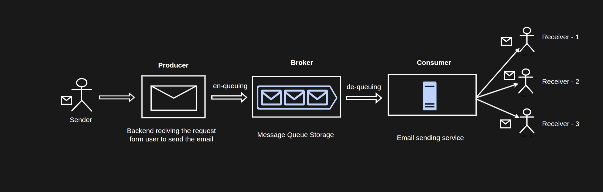

# Background Jobs / Tasks

## What is a background task?

- Any piece of code or workflow that runs outside the request-response lifecycle.
- It doesn't need to happen immediately and isn't mission-critical to the response.
- It's asynchronous, so it can be offloaded to a separate process running in the background and finish task as intended.

## Why we need them: the signup email example

- Flow:
  1. User signs up (email, name, password)
  2. frontend calls the backend API
  3. backend validates (email, password length and complexity)
  4. backend sends a verification email (a link or a 6/8-digit OTP).

- How sending an email works:
  1. The backend builds an HTML template with the code or link,
  2. makes an API call to an email provider (Resend, Mailgun, Brevo, or any SMTP provider) with the recipient, subject, and sender.
  3. The provider checks the API key and ownership, sends the email, and returns success or failure.

- If above steps are synchronous
  - the external provider may be slow or down (traffic spike, downtime), and you have no control over it.
  - Without error handling: the email API fails, so the signup API fails too → bad user experience.
  - With error handling: signup succeeds and the UI says "we've sent you an email", but the email was never sent and that is bad user experience again.
  - The user must click "resend", which is a separate API call, and if the service is still down, the cycle repeats.

- Solution to above issue is a background job:
  1. Server does the initial processing (DB writes, generating the verification code, constructing the email).
  2. Instead of calling the email API in the same request, it serializes all the information needed to send the email (e.g., JSON) and pushes it into a queue.
  3. It immediately returns a success status (200 or 201).
  4. The user instantly sees "verification email sent".
  5. A consumer/worker (a separate process) picks the task from the queue and deserializes it into a native format (dict in Python, object in JS, struct in Go).
  6. The consumer runs the registered handler, which is the same function that would have run synchronously, and calls the email provider's API.

With this approach, even delivery takes milliseconds to at most ~5–10 seconds under heavy traffic. Verification emails typically expire in 15–20 minutes, so this is fine.

- If the external service is down:
  - The handler fails, so the task fails.
  - The task is re-injected into the queue for retry.
  - A popular strategy is exponential backoff: retry after 1 min, then 2, then 4, then 8, and so on.
  - A maximum retry count is configured (e.g., 5).
  - Downtime is usually only seconds or milliseconds, so the task will most likely succeed on the second or third try.
  - Result: the email is still delivered even though the service was briefly down.

- Libraries/frameworks: Celery (Python), BullMQ (Node.js), Asynq (Go).

- Advantages:
  - Faster processing and a responsive backend (API calls aren't blocked by external services or heavy processing).
  - Retry mechanisms for failure-prone tasks.
  - Failure detection.
  - Prevents timeouts caused by dependency on external services.
  - Improves the overall user experience.

## Common tasks offloaded to the background

1. Sending emails: depends on an external service.

2. Processing images/videos: resizing and converting an uploaded image into multiple formats and sizes (smaller for phones, larger for desktops, 2XL/XL) based on network conditions and device.

3. Generating reports: e.g., a project management app sending daily/weekly/monthly reports (stats, completed tasks, pending tasks in a sprint) as an HTML email or PDF, daily at midnight or weekly on Sunday at 12:00. These use cron jobs, and Celery and BullMQ have scheduled task features for specific dates, times, and intervals.

4. Sending push notifications: the app on the phone registers the device with the OS push service (Google or Apple). The backend stores the device code/token in its DB. To notify, the backend calls the Google/Apple service, which delivers the notification (the backend can't send directly to the phone). Since this is an external service call, it's offloaded.

## What is a task queue?

- A system for managing and distributing background jobs.
- It is the engine that lets you reliably hand off work to a separate process.
- Analogy: a to-do list for your backend. Application code adds tasks, and workers pick them off one by one and execute them.

###mponents

- Producer
  - Your application code (Node.js, Python, Go, etc.).
  - Creates the task with all the information the consumer will need (user ID, name, email, the image, report data, etc.).
  - Serializes it (JSON or another serializable format) and pushes it into the queue.
  - Pushing a task is called enqueuing.

- Broker (the queue)
  - Stores tasks temporarily until a worker is ready to process them.
  - A temporary holding area.

- Consumer/Worker
  - Runs in a separate process or thread (it can be in the same codebase or a separate one).
  - Constantly monitors the queue for new items.
  - Takes a task out of the queue, which is called dequeuing, and executes it with the registered handler.
  - Consumer-side configuration: which queue to pick from, what data format to expect (the deserial5ion layer), and which handler to run.
  - Different queues can exist for different purposes (email, in-app notifications, mobile push), with different consumers picking from different queues.

  

###derlying technologies for the broker

- RabbitMQ
- Redis (its Pub/Sub module is commonly used for implementing task queues)
- Amazon SQS: a managed queuing service from AWS, deployed across multiple regions. A good choice for scaling task processing across nodes spread around the world.

###knowledgement and visibility timeout

- When a worker completes a task, it sends an acknowledgement (ack) to the queue, which tells the queue the task succeeded and can be removed.
- If no ack is sent, the queue decides based on parameters whether the task was unresponsive or failed, and applies a retry mechanism.
- Visibility timeout: the period during which a task is considered "in progress" by a consumer.
  - If the worker doesn't acknowledge within that timeout (it crashed, the external service hung, etc.), the queue makes the task available to other consumers.
  - This ensures tasks don't get lost, since the original consumer already removed the task from the queue and then failed to report success or failure.
- Someone must always ack to mark a task as success or failure.
- Frameworks like Celery, BullMQ, and Asynq handle these edge cases.

## Types of background tasks

1. One-off tasks
   - A single task triggered by a scenario in the request-response cycle.
   - Examples: verification email after registration, welcome email after verification, password reset email, notification when someone texts you on a social app.
   - The most frequently encountered type.

2. Recurring tasks / Cron jobs
   - Executed periodically at specific intervals.
   - Examples: daily/monthly/annual reports with stats.
   - Also cleanup/maintenance jobs. Example: with stateful authentication, the sessions table fills with abandoned/orphan sessions from repeated login/logout. A recurring job (every 1–3 months) deletes inactive old sessions to free DB storage.

3. Chain tasks
   - Parent-child (hierarchical) relationships. A task triggers only after its parent task completes successfully.
   - Example: LMS platform (like Udemy) video upload:
     - Instructor uploads a video (e.g., to S3 via a pre-signed URL). The backend acknowledges immediately so the request isn't blocked.
     - Task 1: encode the video into different formats/resolutions for different network conditions and devices (served via CDN).
     - After encoding, two tasks run in parallel (they don't depend on each other):
       - Task 2a: generate thumbnails → then Task 3: process thumbnails into different resolutions (this depends on 2a).
       - Task 2b: generate the audio transcription (subtitles).
     - Both 2a and 2b depend on Task 1 finishing first.

4. Batch tasks
   - A task that triggers many tasks, or many tasks triggered at once.
   - Example 1: delete account
     - The backend can't delete all user data in one request (data may span shards/regions, and it could take 40–60+ seconds).
     - The API immediately responds with success (200), saying deletion is in progress, and the user is logged out.
     - Option A: a grace period (3 or 7 days) in which the user can log back in and cancel the deletion.
     - Option B: no grace period, so deletion proceeds immediately in the background.
     - The consumer picks up the "delete account" task and goes through the user's resources (e.g., removing the user from all projects they own in a project management app), deletes the profile and assets (logos, cover images), deletes the account, and sends a final email saying the account was deleted.
     - The delete account task itself can spawn many sub-tasks (deleting entities, deleting assets).
   - Example 2: reports for thousands of users
     - At midnight or the end of the week, thousands of tasks (generate a report and send it) are triggered at the same time.

## Design considerations (especially at scale)

- Idempotency
  - Tasks must be safely executable multiple times without side effects.
  - In the delete-account example, run everything inside a transaction, so if something fails midway (a DB or external API error) you can do a custom/manual rollback.
  - On retry, the task starts from scratch (0% completion) without leaving a partial state.

- Error handling
  - Must be robust and extensive, since everything runs in a different process.
  - Catch and log errors, and enable retrying of failed tasks.
  - Don't miss bottlenecks or edge cases.

- Monitoring
  - Track the number of tasks in the queue, successful tasks, failed tasks, and the main reasons for failure (external service vs. internal error).
  - Maintain a complete view of the system's status at all times.
  - Tools: Prometheus and Grafana. Metrics are created whenever a trigger happens, inserted into a stack, and persisted to disk with replication.
  - Metrics, logs, traces, and the ELK stack are to be covered in a separate video.

- Scalability
  - Design so you can scale consumers horizontally (add more consumer nodes) when user load increases (e.g., double the users), keeping processing responsive.

- Ordering
  - If tasks must run in a particular order, ensure your library/framework supports ordered delivery.

- Rate limiting
  - For tasks that call external services, implement rate limiting to avoid overloading them.
  - External services charge per API call and have their own rate limits.

## Best practices

- Keep tasks small and focused.
  - One task should handle one processing unit.
  - Divide responsibilities across tasks so one failure doesn't affect the others.
  - If one processing step depends on another, use chain tasks (parent-child). A child can fail and retry (with exponential backoff) without failing the parent.
  - If one big task fails near the end, everything repeats and wastes CPU on the consumer/server.
  - Small tasks are easier to scale, avoid bugs in, monitor, and retry.

- Avoid long-running tasks.
  - Break them into smaller, manageable chunks.
  - A task that takes long is a signal to split it into concurrent tasks or parent-child tasks.

- Use proper error handling and logging.
  - Gives the queue a chance to retry.
  - Gives you the information to debug failures (external service vs. internal error).
  - Makes monitoring easier.

- Constantly monitor queue length and worker health.
  - Set up alerting so you know if the queue length exceeds a limit (then find ways to scale) or if workers go down (then debug why).
  - Ensure the whole background task system is running smoothly at all times.
