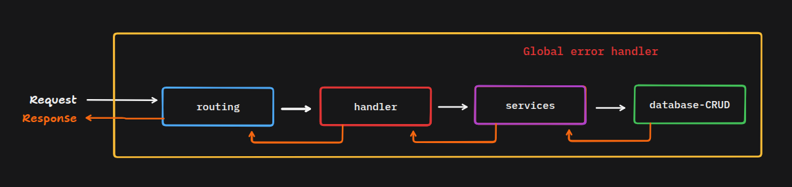

# Error Handling and Building Fault Tolerant Systems

## Errors

- Errors are events that occur during the execution of a program and cause malfunction, unexpected behavior, or a complete crash of the program.
- Fault: the underlying cause, such as a bug, a hardware problem, or a bad configuration.
- Error: the incorrect state the system enters when a fault is triggered.
- Failure: the error becomes visible to the user, such as a crash or a wrong result.
- Fault tolerance: the ability of a system to keep working, even with reduced capacity, when faults happen.
- Operational errors: problems that happen even when the code is correct (network failure, timeout, database down). Handle them by retrying, recovering, or showing a fallback.
- Programmer errors: bugs in the code (a wrong argument, reading a property of undefined). Fix the code instead of handling them at runtime.

## Types of Errors

### Syntax and Compile-Time Errors

The code breaks the language rules or fails the type check, so it cannot be compiled or run.

1. Syntax errors
   - What it is: Missing brackets or semicolons, misspelled keywords, invalid structure.
   - Prevention: Use an editor with syntax highlighting, a linter (ESLint), and a formatter (Prettier).
2. Type and compile-time errors
   - What it is: Wrong types, missing imports, or undefined names caught by the compiler or type checker (for example, TypeScript).
   - Prevention: Use TypeScript in strict mode, run the type check and build in CI, and fix errors before deploying.

### Logical Errors

The code runs, but gives wrong results or behaves incorrectly.

1. Incorrect code
   - What it is: Typos, wrong conditions (`>` vs `>=`), wrong variable used, off-by-one errors.
   - Prevention: Code reviews, linters (ESLint), small functions, meaningful variable names.
2. Wrong algorithm
   - What it is: The approach itself can't solve the problem (e.g., wrong sorting or discount logic).
   - Prevention: Write the logic in plain steps or pseudocode first, and test it with sample inputs by hand.
3. Missed edge cases
   - What it is: Empty input, null/undefined, zero, negative numbers, very large values, duplicates.
   - Prevention: List edge cases before coding, validate inputs (Zod/Joi), and add default or fallback values.
4. Misunderstood requirement
   - What it is: You built something different from what the client or user wanted.
   - Prevention: Confirm requirements in writing, show early demos, and ask questions before building.
5. Wrong function or calculation
   - What it is: Using `parseInt` instead of `parseFloat`, floating-point money errors, wrong date or timezone handling.
   - Prevention: Read the docs, store money as integers (paise/cents), use a date library (date-fns/dayjs), and unit test calculations.
6. Lack of testing
   - What it is: Bugs reach production because nothing caught them.
   - Prevention: Unit tests for core logic, a few integration tests for key flows, and manual testing of the main user journeys.

## Runtime Errors

- The code is syntactically valid and starts fine, but fails while the app is running, usually because of unexpected data or state.
- They can go completely unnoticed until the program crashes or the developer notices them, and they can cause runtime crashes.
- They are unhandled errors or missed edge cases, such as:
  1. `Cannot read properties of undefined`
  2. null/undefined access
  3. type errors
  4. unhandled promise rejections
  5. uncaught exceptions that crash the Node process
  6. JSON parse failures
  7. infinite loops
  8. running out of memory (memory leaks)
- Prevention:
  1. Validate inputs before using them
  2. Use optional chaining (`user?.name`) and default values
  3. Wrap async code in `try/catch`
  4. Add a global error handler in Express
  5. Log `unhandledRejection` and `uncaughtException`
  6. Use a process manager (PM2) to auto-restart on crash
  7. Monitor logs and memory usage

## Data Errors

### Connection Errors

Errors caused by the connection to the database.

1. Credential errors
   - What it is: Wrong username, password, or host, or the user lacks permission.
   - Prevention: Keep credentials in `.env` files, use separate configs per environment, and never hardcode secrets.
2. Timeout errors
   - What it is: The DB doesn't respond in time (slow queries, overloaded server).
   - Prevention: Set sensible timeouts, optimize queries, add indexes, and retry with backoff.
3. Connection pool errors
   - What it is: All connections are in use, or connections leak and never get released.
   - Prevention: Use one shared pool, always release connections (`finally`), set a pool limit, and monitor usage.

### Constraint Violation Errors

Errors caused by the database constraints.

1. Insertion / input mismatch
   - What it is: Wrong data type, missing required field, duplicate unique value, string too long.
   - Prevention: Validate on both frontend and backend, match schema and request body, and handle duplicate errors gracefully.
2. Relational integrity errors
   - What it is: Foreign key violations, such as inserting a child with no parent, or deleting a parent that still has children.
   - Prevention: Insert in the correct order, use `ON DELETE CASCADE` or `RESTRICT` deliberately, and check that the parent exists first.

### Query Errors

Database errors caused by the SQL query.

1. SQL syntax errors
   - What it is: Invalid SQL: missing comma, wrong keyword, bad quotes.
   - Prevention: Test queries in a DB client first, use a query builder or ORM, and format your SQL.
2. SQL execution errors
   - What it is: Valid SQL that fails at runtime: unknown column or table, wrong data type, division by zero.
   - Prevention: Keep migrations in sync across environments, use parameterized queries, and log failing queries.
3. Deadlock errors
   - What it is: Two transactions wait on each other's locks forever.
   - Prevention: Keep transactions short, access tables in a consistent order, and retry the transaction on deadlock.

## 4. External Services Errors

Problems outside your own code or database (APIs, network, third-party tools).

### Connection timeout

- What it is: The external service takes too long to respond.
- Prevention: Set request timeouts, retry with exponential backoff, and show a friendly fallback message.

### DNS resolution errors

- What it is: The domain name can't be resolved to an IP (wrong domain, DNS misconfiguration, DNS outage).
- Prevention: Double-check domain and env URLs, verify DNS records after changes, and allow time for DNS propagation.

### Network partitions

- What it is: Parts of the system can't reach each other even though each is running.
- Prevention: Add retries and timeouts, make operations idempotent, and avoid depending on a single network path.

### Rate limiting (429)

- What it is: You exceed the allowed number of requests to an API.
- Prevention: Cache responses, batch requests, respect `Retry-After` headers, and add your own request throttling.

### Service outages

- What it is: A third-party service (payment, email, hosting) is down.
- Prevention: Handle errors gracefully, use fallbacks or queues to retry later, monitor the provider's status page, and set up alerts.

## Configuration Environment Errors

The code is correct, but the app's settings for its environment are wrong or missing.

### Missing or wrong settings

- What it is: A missing or misspelled env variable, a localhost URL left in production, wrong `NODE_ENV`, a Vite variable without the `VITE_` prefix, or an env change made without restarting or rebuilding.
- Prevention: Keep a `.env.example` with all required variables, validate env variables at startup so the app fails fast with a clear message if something is wrong (it crashes at startup, not at runtime), use separate config per environment, and rebuild or restart after any change.

### CORS errors

- What it is: The browser blocks requests because the backend doesn't allow your frontend's origin.
- Prevention: Configure the `cors` middleware with exact allowed origins, methods, and headers, and update the allowed list for each environment (dev vs production domain).

## Release and Deployment Errors

The code is correct, but the release to the server goes wrong.

### Release problems

- What it is: A failed or partial build, a missing env variable on the server, a stale build served after an update, a port or process manager problem, or the old working app being removed before the new one is confirmed stable.
- Prevention: Don't destroy the old app until the new one is stable. Keep the previous version running (or backed up) and switch over only after the new one passes a quick health check, so you can roll back instantly if something breaks. Also check the logs right after deploying.

### Errors after updates

- What it is: A package, API version, or server update breaks existing behavior.
- Prevention: Pin dependency versions, read changelogs, test in staging first, keep backups, and have a rollback plan.

## Other Common Errors

### Validation errors

- What it is: User input is missing, in the wrong format, or outside the allowed range.
- Prevention: Validate input on the backend (Zod/Joi), return a clear message that names the invalid field, and use status code 400 or 422.

### Authentication and authorization errors

- What it is: The user is not logged in or has an invalid or expired token (authentication), or is logged in but lacks permission (authorization).
- Prevention: Return 401 for authentication failures and 403 for authorization failures, expire and refresh tokens properly, and check permissions on every protected route.

### Resource errors

- What it is: The system runs out of a resource or cannot access it: disk full, file not found, permission denied, too many open files.
- Prevention: Monitor disk and memory usage, close files and connections after use, check that files exist before using them, and set alerts before limits are reached.

### Concurrency errors

- What it is: Race conditions, where two operations change the same data at the same time and the result depends on timing (for example, two users buying the last item).
- Prevention: Use database transactions and locks, unique constraints, and atomic operations, and avoid shared mutable state.

## Best practices for proactive error detection

Finding errors before they happen and fixing them before they spread and cause damage is the best strategy.

1. Test before you ship:
   1. Test every flow of the application with every possible case
   2. Check that observability and monitoring tools are working
   3. Test that automation for reporting errors and creating alerts works, and that it sends emails and notifications as errors happen with minimum latency
   4. Make sure the code and configuration that run the application are production-ready and can bear high traffic peaks
   5. Create `/health` and `/status` endpoints for clients that consume the application as a service
2. Handle errors at different levels:
   1. Errors at the validation layer: return a meaningful error message to the user.
   2. Errors at the compilation layer: debug the error, fix the code, and look for repetitive patterns.
   3. Errors at runtime: log the error, send a friendly message to the user, and show a fallback message.
   4. Errors at the behavior layer: monitor, block unintended behavior, and add fallbacks.
3. Strict Validation Layer:
   1. Validate input by type, range, and length
   2. Check for null/undefined values
   3. Transform input to the expected type
4. Find errors before they occur and spread:
   1. Test application flows with different inputs
   2. Find and fix edge cases
5. Log and monitor errors:
   1. Log errors with enough context to debug them, such as stack traces, and hide user and application secrets.
   2. Monitor errors and warnings in production.
   3. Use observability layers: send notifications, emails, and SMS.
6. External service monitoring:
   1. Set timeouts and retries on every external call, and back off before hitting the limit.
   2. Keep secrets in env files, never in code.
   3. Only trigger external services when needed, and limit their usage.
   4. Create alerts for version changes, updates, and downtime.
7. Versioning and deployment:
   1. Use version control and release management tools.
   2. Never remove the old working version until the new one is stable.
   3. Create a rollback plan.
8. Logging, monitoring, and observability:
   1. Predict the expected usage of performance metrics, resources, and external services; if usage goes over or under the predicted limit, start debugging.
   2. Monitor errors and warnings and log each of them in production in a standardized manner for each error/warning type, handle them differently, and use a format like JSON and tools like Loki and Grafana.
   3. Log errors with enough context to debug them, such as stack traces, and hide user and application secrets.
   4. Track business metrics and business KPIs.

## Handling errors gracefully

When an error occurs, its handling code should try to recover the application from the error state and keep it in a healthy, running state.

### Backoff Strategy

1. On error, the application should not retry immediately. It should wait for a while before trying again.
2. With exponential backoff, the wait time doubles after each failed attempt: 1, 2, 4, 8, 16... seconds (or minutes, depending on the service) before the next retry.
3. Set a maximum wait time and a maximum number of retries, so the app does not retry forever.
4. Add a small random delay (jitter) to each wait, so many clients do not retry at the exact same moment.

### Levels of Error Handling and Reporting

At every level, the app should log and report the error.

- Level 1: Minor error or warning: Show a clear, friendly message to the user.
- Level 2: Repeated or serious error: Send a notification to the developer, because the error is repeating.
- Level 3: Critical error: Send an urgent notification to the developer right away, because the app or a key feature is down. In the case of external services, send an alert to the provider.

### Reducing Load on External Services

If the error is caused by an external service, the app should not retry immediately, because that adds more load on a service that is already struggling. Instead, use a backup plan:

- Switch to a secondary service (for example, a backup email or payment provider).
- Put the request in a queue and retry later, once the service has recovered.
- Combine this with exponential backoff so retries are spaced out.

### Non-Recoverable Errors

#### Whole app is affected

- Stop the failing process so it does not cause more damage (such as corrupted data).
- Notify the developer right away.
- Show a friendly message to the user saying the app is currently down.

#### Only one feature is affected

- Disable that feature to contain the error, so the rest of the app keeps working.
- Also disable every entry point that uses the same feature (buttons, forms, API routes), so users cannot trigger the same error again.
- This is called graceful degradation: the app keeps running with reduced functionality instead of failing completely.
- Show a short message where the feature was (for example, "Payments are temporarily unavailable") and turn it back on once the issue is fixed.

## Fault Tolerance Patterns

Techniques that keep the system running when parts of it fail.

### Circuit breaker

- What it is: A wrapper around calls to an external service that stops calling it after repeated failures, like an electrical circuit breaker.
- How it works: It has three states: closed (calls go through), open (calls fail immediately or use a fallback), and half-open (a few test calls check whether the service has recovered).
- How it helps: The app does not waste time and resources on a service that is already down, and the service gets time to recover. Combine it with timeouts, backoff, and fallbacks.

### Redundancy and replication

- What it is: Keeping more than one copy of a component (servers, database replicas), so there is no single point of failure.
- How it helps: If one copy fails, another continues to serve requests.

### Failover

- What it is: Automatically switching from a failed component to a standby one (for example, promoting a database replica to primary).
- Watch out for: Test the failover regularly, and make sure data is replicated before the switch.

### Load balancing

- What it is: Spreading incoming requests across several servers.
- How it helps: No single server is overloaded, and unhealthy servers can be removed from rotation using health checks.

### Bulkhead

- What it is: Isolating resources (connection pools, queues, threads) per feature or service, like the sealed sections of a ship.
- How it helps: A failure or overload in one part (for example, a slow payment service) does not use up the resources of the rest of the app.

### Fail fast

- What it is: Detect a problem as early as possible and stop immediately with a clear error, instead of continuing in a bad state.
- How it helps: Bugs are found early, close to their cause, and bad data does not spread (for example, validating env variables at startup).

### Graceful shutdown

- What it is: When the process receives a stop signal (`SIGTERM`), it stops accepting new requests, finishes the requests in progress, closes database connections, and then exits.
- How it helps: Restarts and deployments do not interrupt users or corrupt data, which makes the Restart strategy safer.

## Error Recovery Strategies

### Automatic Error Recovery

When the app is in an error state, there are several ways it can recover automatically.

1. Retry:
   - Use when: The error is temporary (network glitch, brief timeout, short service hiccup).
   - How it helps: Trying again often solves the problem without any other action.
   - Watch out for: Retrying too fast or forever. Use exponential backoff, a maximum retry count, and only retry operations that are safe to repeat (idempotent).
2. Restart:
   - Use when: The error is persistent and the app is stuck in a bad state (memory leak, hung process, crashed worker).
   - How it helps: A restart brings the app back to a clean, healthy state.
   - Watch out for: Side effects such as data loss, users being logged out, and interrupted requests. Use a process manager (PM2) for auto-restart, save important state before shutting down, and add a limit so a crash loop does not restart forever.
3. Cleanup:
   - Use when: The error is caused by a bug that left the app's state corrupted or inconsistent.
   - How it helps: The app clears or resets the bad state (cache, session, temporary data) to defaults and continues from a known good point.
   - Watch out for: Part of the data may be lost, so only reset what is broken, take a backup first when possible, and log what was cleaned up.
4. Switch to a backup service:
   - Use when: The error is caused by an external service that is down or failing.
   - How it helps: The app moves to a secondary service that is not affected (for example, a backup email or payment provider), so users are not blocked.
   - Watch out for: An untested or misconfigured backup service. Keep the backup service tested and configured, and switch back to the main service once it recovers.

> Whichever strategy works, log and document it, and create error handbooks for developers if the same error keeps coming back. Also, try to automate the recovery process.

### Manual Error Recovery

When the app is in an error state and automatic recovery does not work, a developer can recover it manually.

1. Check past logs and docs
   - Use when: The error looks familiar, or you do not know where to start.
   - How it helps: Search past logs, incident notes, and docs for similar errors and how they were solved. This often saves a lot of debugging time.
   - Watch out for: Old fixes may not fit the current version of the app. Confirm the cause first, and write down every new error and its solution so the next search is easier.
2. Data backup and recovery
   - Use when: Data is lost, corrupted, or wrongly changed.
   - How it helps: This is the most important part of manual recovery. The app itself can always be re-created and re-run from the codebase, but lost data cannot.
   - Watch out for: Backups that were never tested. Take regular automatic backups, store them away from the main server, and test restoring them from time to time.
3. Error escalation control
   - Use when: A dependency (external service or database) fails, and you must decide whether to handle the error where it happened or pass it up to a higher level.
   - How it helps: Not every error needs to be handled the moment it occurs. If a service or database is down for a few seconds, a retry at the lower level can absorb it. If it stays down for more than a few minutes, the error should be propagated to a higher level, where it can trigger a backup service, a developer notification, or a friendly message to the user.
   - Watch out for: Swallowing errors silently, or propagating too early and showing users errors for tiny glitches. Set a clear time limit (for example, a few minutes) for when to stop absorbing and start escalating.
4. Error propagation and bubbling
   - Use when: An error happens in a low-level function that cannot fix it, so it is passed up to the calling function, layer by layer, until a higher level handles it. This is how propagation works in code.
   - How it helps: Error handling stays in one place, and the higher level has more context to decide the right action.
     - Database layer: the query fails and throws an error.
     - Service layer: does not catch it, so it moves up.
     - Controller layer: catches it and forwards it with `next(err)`.
     - Global error handler: logs it and sends one friendly message to the user.
   - Watch out for: An empty `catch {}` that hides the error, catching an error and returning nothing so the caller thinks it worked, losing the original error when re-throwing (keep it with `new Error('message', { cause: err })`), and not passing async errors to `next(err)` in Express.
   - Handle the error where it happened only if that layer can fix it, such as retrying a short glitch or using a default value. Otherwise, let it bubble up.
5. Loosely coupled systems
   - Use when: Services or layers depend on each other directly through request-response calls, and one failing service causes errors to spread to the others.
   - How it helps: Instead of passing messages and errors through the request-response cycle, use a message queue such as RabbitMQ or Kafka. Layers communicate through a publish-subscribe (pub/sub) model: the sender publishes a message and does not wait for the receiver. This reduces dependency between services, and an error in one service does not propagate to the others. Messages wait in the queue until the receiver is back, so nothing is lost.
   - Watch out for: Added complexity, since you now run and monitor a message broker. Handle failed messages with retries and a dead-letter queue, make consumers idempotent (the same message may be delivered twice), and monitor queue size so a growing backlog does not go unnoticed.
   - For small projects, add a message queue only when you really need it, such as sending emails, notifications, or payment callbacks. A plain request-response flow is simpler and enough for most features.

## Error Recovery Strategies

### Automatic Error Recovery

When the app is in an error state, there are several ways it can recover automatically.

1. Retry:
   - Use when: The error is temporary (network glitch, brief timeout, short service hiccup).
   - How it helps: Trying again often solves the problem without any other action.
   - Watch out for: Retrying too fast or forever. Use exponential backoff, a maximum retry count, and only retry operations that are safe to repeat (idempotent).
2. Restart:
   - Use when: The error is persistent and the app is stuck in a bad state (memory leak, hung process, crashed worker).
   - How it helps: A restart brings the app back to a clean, healthy state.
   - Watch out for: Side effects such as data loss, users being logged out, and interrupted requests. Use a process manager (PM2) for auto-restart, save important state before shutting down, and add a limit so a crash loop does not restart forever.
3. Cleanup:
   - Use when: The error is caused by a bug that left the app's state corrupted or inconsistent.
   - How it helps: The app clears or resets the bad state (cache, session, temporary data) to defaults and continues from a known good point.
   - Watch out for: Part of the data may be lost, so only reset what is broken, take a backup first when possible, and log what was cleaned up.
4. Switch to a backup service:
   - Use when: The error is caused by an external service that is down or failing.
   - How it helps: The app moves to a secondary service that is not affected (for example, a backup email or payment provider), so users are not blocked.
   - Watch out for: Keep the backup service tested and configured, and switch back to the main service once it recovers.

> Whichever strategy works, log and document it, and create error handbooks for developers if the same error keeps coming back. Also, try to automate the recovery process.

### Manual Error Recovery

When the app is in an error state and automatic recovery does not work, a developer can recover it manually.

1. Check past logs and docs
   - Use when: The error looks familiar, or you do not know where to start.
   - How it helps: Search past logs, incident notes, and docs for similar errors and how they were solved. This often saves a lot of debugging time.
   - Watch out for: Old fixes may not fit the current version of the app. Confirm the cause first, and write down every new error and its solution so the next search is easier.
2. Data backup and recovery
   - Use when: Data is lost, corrupted, or wrongly changed.
   - How it helps: This is the most important part of manual recovery. The app itself can always be re-created and re-run from the codebase, but lost data cannot.
   - Watch out for: Backups that were never tested. Take regular automatic backups, store them away from the main server, and test restoring them from time to time.
3. Error escalation control
   - Use when: A dependency (external service or database) fails, and you must decide whether to handle the error where it happened or pass it up to a higher level.
   - How it helps: Not every error needs to be handled the moment it occurs. If a service or database is down for a few seconds, a retry at the lower level can absorb it. If it stays down for more than a few minutes, the error should be propagated to a higher level, where it can trigger a backup service, a developer notification, or a friendly message to the user.
   - Watch out for: Swallowing errors silently, or propagating too early and showing users errors for tiny glitches. Set a clear time limit (for example, a few minutes) for when to stop absorbing and start escalating.
4. Error propagation and bubbling
   - Use when: An error happens in a low-level function that cannot fix it, so it is passed up to the calling function, layer by layer, until a higher level handles it. This is how propagation works in code.
   - How it helps: Error handling stays in one place, and the higher level has more context to decide the right action.
     - Database layer: the query fails and throws an error.
     - Service layer: does not catch it, so it moves up.
     - Controller layer: catches it and forwards it with `next(err)`.
     - Global error handler: logs it and sends one friendly message to the user.
   - Watch out for: An empty `catch {}` that hides the error, catching an error and returning nothing so the caller thinks it worked, losing the original error when re-throwing (keep it with `new Error('message', { cause: err })`), and not passing async errors to `next(err)` in Express.
   - Handle the error where it happened only if that layer can fix it, such as retrying a short glitch or using a default value. Otherwise, let it bubble up.
5. Loosely coupled systems
   - Use when: Services or layers depend on each other directly through request-response calls, and one failing service causes errors to spread to the others.
   - How it helps: Instead of passing messages and errors through the request-response cycle, use a message queue such as RabbitMQ or Kafka. Layers communicate through a publish-subscribe (pub/sub) model: the sender publishes a message and does not wait for the receiver. This reduces dependency between services, and an error in one service does not propagate to the others. Messages wait in the queue until the receiver is back, so nothing is lost.
   - Watch out for: Added complexity, since you now run and monitor a message broker. Handle failed messages with retries and a dead-letter queue, make consumers idempotent (the same message may be delivered twice), and monitor queue size so a growing backlog does not go unnoticed.
   - For small projects, add a message queue only when you really need it, such as sending emails, notifications, or payment callbacks. A plain request-response flow is simpler and enough for most features.

## Global Error Handling

- The most important error handling in any app is the global error handler, which acts as the final safety net of the app.
- Setting up a global error handler is a good practice to handle all errors in the app and should be done in the early stages of the project. Global Error Handler as Wrapper

- The global error handler is a wrapper over the complete request-response cycle and will catch and handle all errors in the app.
- It can format the error message, attach important information like the stack trace, error code, and error message, and hide sensitive information that reveals the internal workings of the app. Errors with a detailed stack trace are usually logged but not sent to the client; instead, a generic error message is sent to the client.
- After correctly formatting the error message, it can send the error message to the client or log it to the console.

### Advantages of Error Handling

1. More robust and secure applications:
   - Error handling helps prevent unexpected crashes and bugs that can compromise the integrity of the application.
   - It allows the application to recover from errors and continue running, minimizing downtime and data loss.
2. Reducing redundancy / duplication of the same error handling code:
   - To handle exactly the same logic and code in multiple places, it is better to have it in one place and reuse it.
   - The same error thrown in multiple places can be handled in the same way and responded to with the same error message.

## API Error Responses

### HTTP status codes

- 4xx are client errors: 400 bad request, 401 unauthorized, 403 forbidden, 404 not found, 409 conflict, 422 validation error, 429 too many requests.
- 5xx are server errors: 500 internal server error, 502 bad gateway, 503 service unavailable, 504 gateway timeout.
- Use the correct status code so the client knows whether to fix the request or retry later.

### Consistent error response format

- Return every error in the same structure, so clients can handle all errors in one way.
- Typical fields: HTTP status, an error code, a short generic message, and a request ID.
- Do not include stack traces or internal details.

### Custom error classes and error codes

- What it is: Your own error classes (for example, `ValidationError`, `NotFoundError`) that extend `Error` and carry a status code and an error code.
- How it helps: The global error handler can read these fields to choose the status code and message, and to tell expected (operational) errors from unexpected bugs.
- Error codes (for example, `USER_NOT_FOUND`) let clients and logs identify an error without depending on the message text.

## Tracing, Tracking, and Alerting

### Request IDs (correlation IDs)

- Generate a unique ID for each request (or accept it from the incoming header), attach it to every log line, and include it in the error response.
- How it helps: You can follow one failing request across layers and services, and a user can report the ID when something fails.

### Error tracking tools

- Tools such as Sentry collect errors automatically, group similar errors, show the stack trace and the release where the error started, and send alerts.
- They complement log tools like Loki and Grafana, which are better for searching logs and viewing metrics.

### Alert thresholds

- Alert on conditions, not on every single error: error rate above a limit, latency above a limit, repeated failures of the same type, a service down, or memory or disk usage near its limit.
- Match the alert level to the levels in Levels of Error Handling and Reporting, and tune thresholds to avoid alert fatigue (too many alerts that get ignored).

## Failure Testing

- Test failure paths, not only normal flows: simulate timeouts, a database that is down, invalid input, and an external service returning errors.
- Load testing shows how the app behaves under high traffic.
- Chaos testing deliberately breaks parts of the system (stopping a server, blocking the network) in a controlled way to check that recovery works.
- Run these tests in staging first.

## Security policies of error handling

1. Prevent leakage of system internal details and user details in responses
2. Clean up sensitive data and format the data for better readability and usability in a standardized manner that can be sent to the client or to logging modules
3. A generic message can make your system more robust, as attackers have less knowledge about the system and can't easily exploit it
4. As logs can be sent to monitoring services, it's better to hide all sensitive data, such as the actual data used in user details
5. Use the same generic message for failed logins (for example, "Invalid username or password"), so attackers cannot tell whether an account exists
6. Fail securely: when an error occurs, deny access instead of allowing it
7. Never log passwords, tokens, or other personal data
8. Limit or lock repeated failed attempts to slow down brute-force attacks

Resource: [OWASP Authentication Cheat Sheet](https://cheatsheetseries.owasp.org/cheatsheets/Authentication_Cheat_Sheet.html)
