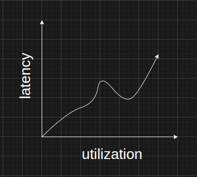
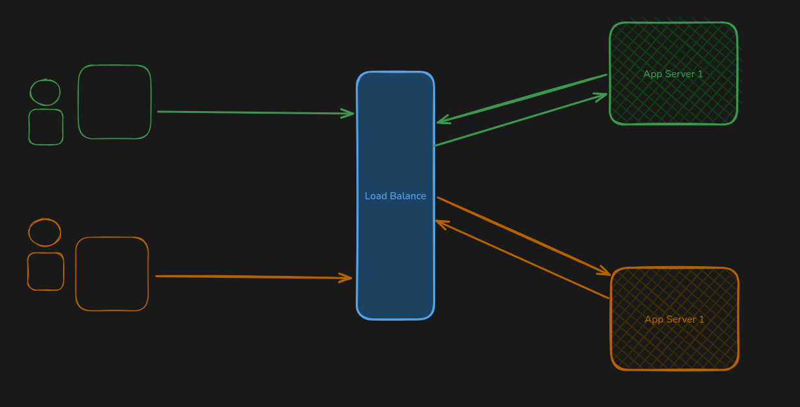
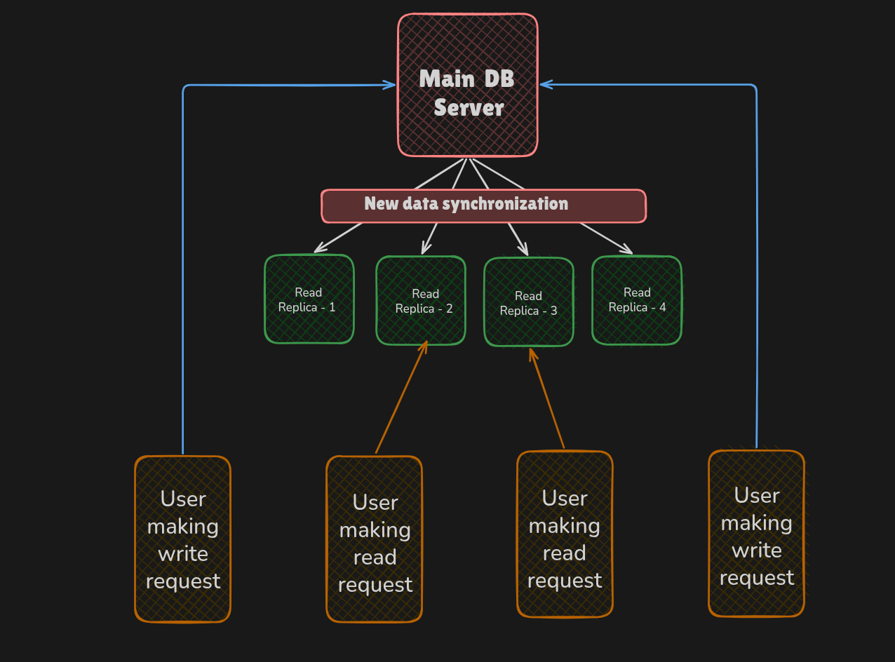

# Scaling & Performance

## Latency

- Latency is the time taken by the system from the user request until the response is rendered. The lower the latency, the more performant the system is.

- Average is the `sum of all values / totalCount`, showing the typical value. 4=liers (extreme values) affect it and can create false averages, whereas percentile is the rank of a value compared to the rest of the values. For example, the 90th percentile means you scored higher than 90% of people. Outliers do not affect it.

- In backend, average latency is the mean: `total time of all requests ÷ request count`.
  - All requests average 50 ms, but a few very slow requests can skew it and hide problems.

- In backend, percentile latency (`p50`, `p95`, `p99`) is the response time under which that percentage of requests complete.
  - `p95`: latency is the response time that 95% of requests stay under. It shows tail latency, meaning what the slowest users actually experience.

  - `p99 = 800 ms` : 99% of requests finish within 800 ms and only 1% take longer than 800 ms.

  - `p95 = 200 ms`: 95% of requests finish within 200 ms and the other 5% take longer than 200 ms.

  - `p50 = 50 ms` : half of all requests finish within 50 ms. This is the median, or typical, request.

- Suppose 100 requests take 50 ms each, except 5 that take 2,000 ms. The average is about 148 ms, which looks fine, but p99 is 2,000 ms, which exposes the slow requests the average hides.

- In latency, we mostly consider percentiles (`p95`, `p99`) rather than the average, because the average hides slow requests, while percentiles show what the slowest users actually experience. The average is still useful as a rough overall indicator.

## Throughput

- Throughput is the number of requests the system can serve in a given amount of time, for example `10 parallel requests per minute`.

- Throughput helps developers understand how the system performs under different traffic loads, particularly traffic surges, because as throughput increases, latency also starts to rise dramatically.

## Utilization

- Suppose a hotel serves biryani, and one person is enough to serve 10 customers, with every customer getting their order within 5 minutes. After that, with every added customer, 30 seconds is added to the waiting time as the number of customers grows. Also, the hotel has seating for 20 customers at a time. If on average each customer takes 10 minutes at the table, any customer after the 20th has to wait until previous customers are served and finish their biryani. In order to serve the customers better we can improve the serving time or increase the number of seats in hotel.

- Similarly, in a backend system, as more requests are accepted, the server's utilization goes higher and the serving time for each parallel request also grows. Once the limit of parallel requests is reached, the extra requests wait in a queue. The more requests in the queue, the longer each new request has to wait. To improve response time, we can scale vertically by adding more resources to the server, or scale horizontally by adding more replicas of the application.

- Zero utilization means the server is idle and doing nothing at all, and max-out utilization means the server is being used to its fullest capacity and can crash if more load is forced on it.

- As utilization increases, latency also increases. At low utilization, system goes closer to idle state. Latency rises wit utilization ans as utilization reaches to its fullest capacity, latency of system grows until server is completely.

## System Bottleneck

- Something that takes longer time to process and slowing down the system is the bottleneck of system like database operations taking too much of time that slows down the whole processes.

> If you are anticipating an requests and utilization surges then its recommend to upgrade the system resources and keep an buffer in case of more load or backup machines if anything fails. Thumb rule of resources procurement it normal usage should be consuming 60-80% and rest stay reserver for spiking traffic.

### Bottleneck Monitoring

1. In a production application, API requests are taking 50% longer than expected.

2. After inspection, you find that this is only happening when database queries are executed.

3. To address database latency, caching is a standard practice, so you add a caching layer. It takes one week to implement and fully merge into the codebase. However, it reduces the response time by only 10%, and API calls are still slower than expected.

4. Upon further inspection, you investigate everything and discover that the logging function called by the service is synchronous, which is the root cause of the slow performance.

By the above example, we can understand the problem with making assumptions without monitoring or debugging to identify the actual root cause. Implementing a solution based on an incorrect assumption means the actual problem persists longer, wasting the time and effort spent implementing a solution that does not fix it.

> Always measure and debug the root cause before making assumptions about an issue, and never implement a solution until the root cause of the issue has been diagnosed.

### Bottleneck Profiling

- Profiler is software that attaches to an application and traces the request-response cycle, providing a detailed report of what happens during a request's lifecycle, including request acceptance, processing, and response generation.

- A Flame Stack (Flame Graph) is a visualization used in application profiling to identify performance bottlenecks.Each block represents a function, its width indicates CPU usage, and its vertical position represents the call-stack hierarchy. Install `perf` and clone the FlameGraph repository, record application CPU activity, generate stack traces, convert them using `flamegraph.pl`, and open the generated `flamegraph.svg` in your browser.

- Distributed tracing monitors each request separately and pinpoints which operations consume resources and how much time each operation takes.

### Bottlenecks in Databases

- In most applications, databases are a common bottleneck because they perform the heavy lifting of CRUD operations. Since databases are often accessed remotely, operations can take time to complete while ensuring ACID properties and providing features to manipulate data efficiently. Common database problems that cause bottlenecks:

#### 1. N+1 Query Problem

     - Occurs when an application executes one query to fetch a list of records and then executes an additional query for each record, resulting in N+1 database queries instead of a single optimized query.
     - Solution: Use JOINs, eager loading, or batch queries to reduce the number of database queries.

#### 2. DB Request Overhead

- The additional time and resources consumed by establishing connections, sending queries, and receiving responses between the application and database.
- Solution: Use connection pooling, query batching, and reduce unnecessary database round trips.

#### 3. Absence of Indexes

- Without indexes, databases may perform full table scans to locate records, increasing query execution time and resource consumption.

- Solution: Create appropriate indexes on frequently queried, filtered, and joined columns.

- Although indexes improve search performance, they come at the cost of additional storage space and slower write operations, as write operation / modifications to indexed fields require the database to update the corresponding index entries. So, choosing which column to index and what type of index to use should be a well-thought-out decision.
  > To decide when and which indexes to use, analyze query execution plans using built-in database tools such as `EXPLAIN` and `EXPLAIN ANALYZE` in PostgreSQL and `explain()` with `executionStats` in MongoDB to understand how queries are executed internally.

#### 4. Cost of connections

- When the database is installed locally on the same machine as the application, communication generally performs better due to low network latency. However, using a remote database introduces additional network latency, communication overhead, and security considerations.

- Each time a new connection is established with a database server, it may involve a TCP three-way handshake, database authentication, TLS negotiation (if encryption is enabled), and session initialization, including resource allocation and, finally, closing the connection after the transaction completes. All these steps introduce additional latency and overhead.

- Also, depending on the database server's available resources, the number of concurrent connections it can handle is limited. With more traffic and utilization DB connection can exhausted.

- To overcome this issue, database connection pooling is used. It avoids creating a new connection for every request and exhausting the database's connection limit. A connection pool acts as a mediator between the application and the database, maintaining a predefined number of active connections. Whenever the application needs to communicate with the database, it borrows an available connection, uses it, and returns it to the pool.

- Database drivers often provide built-in connection pooling. However, when an application scales horizontally across multiple instances, each instance maintains its own connection pool, potentially exceeding the database server's maximum connection limit. This can cause connection exhaustion, increased latency, and failed requests. To address this, external connection poolers such as `PgBouncer` (PostgreSQL) can be used to share a smaller number of database connections across multiple application instances.

#### 5. Large Query Processing Time

- Even with an optimized database setup, caching can further improve performance by reducing repeated database queries. It stores the results of expensive queries and serves them until the underlying data changes or the cache expires. Without proper cache invalidation, stale data may be served, resulting in inconsistencies between the cache and the database.

- However, deciding when to serve cached data, synchronize it with the database, and invalidate stale cache entries is a major challenge. Time-based invalidation (TTL) and event-based invalidation are two commonly used techniques to address this problem. The best approach is often a hybrid strategy where cached data has a TTL and is also invalidated whenever the underlying database data is updated.

- Cache storage options
  1. Local Caching: Uses language/framework data structures (e.g., `Map`) to store cached data in application memory. However, when multiple application instances are running, each maintains its own cache, potentially causing cache inconsistencies.

  2. Distributed Caching: Uses external services such as Redis or Valkey that run independently of application instances. This helps maintain a shared cache across instances but introduces network latency and an additional service dependency.

  > To implement tiered caching, the database remains the source of truth, while frequently accessed data is promoted to the local cache (L1) and other cached data is maintained in the distributed cache (L2). Cache access frequency can be tracked using counters or metrics to identify hot data. Database writes should trigger cache updates or invalidation to maintain consistency.

- Caching Patterns decide when to cache data.
  1. Cache-Aside (Lazy Loading): Check the cache; if the data is found, return it. Otherwise, fetch it from the database, store it in the cache, and return it to the application.

  2. Write-Through: Every write operation updates both the database and the cache synchronously, ensuring that the cache remains consistent with the database.

  3. Write-Behind (Write-Back): Write data to the cache first and asynchronously persist it to the database later, improving write performance but introducing a risk of data loss if the cache fails before the data is persisted.

- Cache Hit Rate:

  - The percentage of cache requests successfully served from the cache instead of fetching data from the database.

  - 90% hit rate means 90 out of every 100 requests are served from the cache, while the remaining 10 require fetching data from the database.

  - If the cache hit rate is low, the following factors might be responsible:
    1. Large TTL: Cached data may remain stale or may not be refreshed appropriately. (Note: A large TTL does not directly cause a low hit rate.)

    2. Insufficient Cache Size: The cache may evict frequently accessed data due to limited capacity.

    3. Data Access Patterns: Frequently requested data may change over time, or user access patterns may vary, resulting in more cache misses.

## Scaling

- When application traffic increases, resource utilization also increases, throughput may decrease, and latency may increase. To overcome this, we can scale system resources or create additional application instances (replicas) to handle the increased traffic efficiently. This process is called scaling.

### Vertical Scaling

- When you increase the resources of a single machine (CPU, RAM, etc.) to handle more traffic, it is called vertical scaling (scaling up).

- Advantages:

  1. Simpler and less complex because the application continues running on the same machine.

  2. Generally cheaper than horizontal scaling.

  3. No need to manage multiple application instances or configure a load balancer.

- Disadvantages:

  1. Has hardware limitations and cannot scale indefinitely as traffic grows.

  2. Creates a Single Point of Failure (SPOF) because the entire application depends on a single machine.

  3. Without geographic distribution, users accessing the application from distant regions may experience higher network latency.

- Trade-offs:

  1. Upgrading hardware may require stopping the application and restarting it, depending on the infrastructure.

  2. Scaling down when traffic decreases may also require downtime.

### Horizontal Scaling

- When you increase the number of application replicas across multiple machines and distribute incoming requests among them using a load-balancing algorithm, it is called horizontal scaling (scaling out). Its a technique of managing multiple server instances and distributing incoming requests using a load balancer.

- Advantages:

  1. Depending on traffic, the system can easily scale up or down by adding or removing application instances.

  2. If one server fails, incoming requests can be routed to another healthy server, improving availability and reducing downtime.

  3. Geographic distribution can be improved by deploying servers across multiple regions where the user base is located, minimizing network latency.

- Disadvantages:

  1. Every additional server increases infrastructure costs and management complexity.

  2. Requires a load balancer to distribute incoming requests.

  3. Concurrent requests accessing the same resources can create conflicts, requiring proper synchronization and coordination.

  4. Inter-server communication, server availability, and automatic recovery after failures introduce additional complexity.

- Trade-offs:

  1. A load balancer requires proper configuration, including routing algorithms, health checks, and connection management.

  2. Every solution to these challenges involves trade-offs in terms of cost, complexity, performance, and availability.

#### Statelessness of Server

- Statelessness is a core concept that enables horizontal scaling. It requires the application to be designed so that no server instance stores client-specific state exclusively in its local memory or storage. Instead, state should be stored and shared through external services such as Redis or a database, allowing any server instance to handle incoming requests.

- Common examples of implementing statelessness in an application are:

  1. Session Data Storage: Storing session data to validate user sessions, track revoked tokens, and maintain temporary records of blocked or rate-limited users. This allows any server instance to validate a user's session without depending on locally stored session data.

  2. Caching: Storing frequently requested data in a shared cache such as Redis. This allows every server instance to access the same cached data instead of maintaining separate local caches.

  3. File Storage: Storing uploaded files in external storage such as AWS S3 or Cloudinary instead of the local server filesystem. This allows any server instance to access the same files regardless of which instance handled the upload.

  4. Background Job Management: Storing background jobs in a shared queue such as Redis with BullMQ. This allows multiple server instances or dedicated workers to process jobs without depending on local server memory.

  5. Application State: Storing shared application state, such as user preferences, shopping carts, and temporary workflow data, in a centralized database or distributed cache so that any server instance can access and update it.

- Design of distributed application servers should follow these rules:

  1. Don't store client-specific state exclusively on an individual server instance, use shared external storage.

  2. Results should be consistent regardless of which server instance processes the request.

  3. Ensure that any server instance is independent to server incoming requests.

  4. Make APIs idempotent wherever possible to handle retries safely.

  5. Use centralized external services and logging, monitoring, and distributed tracing to observe all server instances.

  6. Implement health checks so unhealthy instances can be removed from load balancing.

  7. Avoid relying on in-memory background jobs or timers; use a shared job queue and dedicated workers.

  8. Handle concurrent requests safely using database transactions, locking, or other synchronization mechanisms.

#### Load-balancer

- Load balance is the first component of distributed backend system. It is first thing that intercepts the user request and best on a algorithm it sends request to available server which start processing it.

- Flow of server in distributed system and load balancer

  1. Client sends an HTTP request.

  2. Load balancer receives the request.

  3. Load balancer selects a healthy server based on its configured routing algorithm.

  4. Load balancer forwards the request to the selected server.

  5. Server process the request and sends the response back to the load balancer.

  6. Load balancer forwards the response to the client.

- Algorithm perfuming the server selection are

  1. Round Robin:
     - The load balancer maintains a list of healthy servers and forwards requests sequentially to each server. For example, if there are 3 servers, the first request goes to Server 1, the second to Server 2, the third to Server 3, and the fourth goes back to Server 1. This cycle continues.
     - Round Robin works best when requests have approximately equal processing requirements and all servers have similar resource capacities.

  2. Weighted Round Robin:
     - In distributed systems, some servers may have more resources than others and can handle more requests or workloads. In such cases, the Weighted Round Robin algorithm is used. Requests are distributed among servers based on their assigned weights, allowing more powerful servers to receive a proportionally higher number of requests than less powerful servers.

  3. Least Connections:
     - A server can handle multiple requests simultaneously, and each request may maintain an open connection until a response is received.

     - With the Least Connections algorithm, the load balancer tracks the number of active connections on each server and forwards new requests to the server with the fewest active connections.

     - The server with the fewest active connections is assumed to be less utilized and better positioned to handle additional requests.

  4. Least Response Time:
     - The load balancer tracks the response time of each server and forwards new requests to the server with the lowest average response time.

     - This helps route requests to servers that are currently responding faster.

     - Some implementations also consider the number of active connections to avoid overloading a server.

- Load Balancer Handling Server Crashes:

  - Every server has a health check endpoint that provides information about the server's health with minimal processing and a quick, short response.

  - The load balancer periodically polls (sends requests to) each server to check its health. If the server responds successfully, the load balancer continues forwarding user requests to it.

  - If a health check fails, the load balancer stops forwarding user requests to that server.

  - The load balancer continues sending health check requests to the failed server. Once the server responds successfully again, the load balancer marks it as healthy and resumes forwarding user requests to it.

> Horizontal scaling make sense in most of the scenarios when your infrastructure budget get bigger with you client base / revenue from them.

### Database Scaling

- Since application servers are stateless, creating and deploying replicas becomes easier. However, scaling shared storage systems such as databases, file storage, and cache stores is more complex. Keeping these shared resources synchronized and ensuring consistent results across all server instances becomes difficult and crucial.

#### 1. Read Replicas

- In distributed applications with multiple application servers, a single database server can become a bottleneck as client requests increase. Its resources can become overwhelmed, and the time required to perform heavy database operations remains a limiting factor.

- In this technique, multiple replicas of the primary database server are created. They continuously receive new data from the primary server through replication (streaming or polling). Read requests are handled by replicas, while write requests are handled by the primary server. Updates are then replicated to the read replicas.

- In read-heavy systems, this approach improves database response times and reduces the load on the primary server because it primarily handles write requests. Since read requests often significantly outnumber write requests, implementing read replicas can improve performance in many systems.

- Application servers and database read replicas are deployed together in different regions so that read traffic from each region is routed to the application servers and handled by the read replicas deployed in that region. This reduces the load on the primary server and database and improves latency for both the backend and users.

- The problem is synchronization and consistency between the primary database and its replicas. If a read request follows a write request, the updated data may not yet be available on the replica until the next synchronization cycle completes. Due to network latency and physical distance between regions, replication cannot always happen in real time, even with optimized approaches. Some replication lag is inevitable. Some common solutions to these problems are:
  1. Serve read requests from the primary database when the replica has not yet synchronized, or maintain the updated data in the cache until synchronization is complete.
  2. Delay subsequent read requests from the frontend until the replication lag is resolved.

> Read replicas are a tried-and-tested solution supported by most hosting providers, such as AWS, and databases, such as PostgreSQL, with highly optimized implementations. As a backend engineer, you typically need to configure them with minimal effort.

#### 2. Sharding / Partitioning

- Query Latency: When a database contains a very large number of records (millions or billions), queries may take considerably longer to execute, regardless of how well they are optimized or which indexing techniques are used.

- Scaling Database: With such large databases, scaling the database infrastructure, managing synchronization, and handling records become complex and tedious.

- To solve both of these problems, sharding comes into play.

- Sharding is a technique in which we split a database into smaller parts and manage the records separately. This reduces query latency and helps scale the database.

- To split the database, we define a shard key that determines which database stores each record.

- Examples:

  - Orders Database: Shard order records based on the customer's geographical region.

  - Payments Database: Shard payment records based on quarterly or yearly time periods.

- The backend application handles the logic of determining which database to query based on the shard key.

- Contemporary distributed database services include PlanetScale (MySQL with Vitess), NeonDB (serverless PostgreSQL built on Rust), CockroachDB, `YugaByteDB`, and many others. They provide solutions such as sharding, replication, and distributed transactions. As a backend engineer, prefer using these managed services to avoid the complexity of self-hosting, configuring, and maintaining distributed database infrastructure.

### CDN Caching

- Request Latency and Distance Limitation :

  - The fastest medium for data transmission is currently fiber-optic cable, which transfers data using light. Light travels through optical fiber at approximately 200,000 km/s.

  - When a request is made from Tokyo, Japan, to a server in AWS US-East-1 which is in Northern Virginia (approximately 10,900 km), the theoretical minimum one-way transmission time is around 55 ms, resulting in a minimum round-trip time (request and response) of around 110 ms. In reality, network routing and infrastructure add latency, so the actual round-trip time can be around 130–200 ms. This does not even include server-side request processing or external service calls like DB.

  - Considering network round-trip latency, request deserialization, validation, business logic execution, database queries, and external service calls, the total response time can reach approximately 300–800 ms or more, depending on the workload and infrastructure.

    | Processing layer                       | Estimated latency |
    | -------------------------------------- | ----------------- |
    | DNS lookup (if not cached)             | 1–20 ms           |
    | TCP connection establishment           | 40–80 ms          |
    | TLS handshake (if a new connection)    | 40–80 ms          |
    | Network request and response (RTT)     | 150–180 ms        |
    | Request deserialization                | 1–5 ms            |
    | Authentication and authorization       | 2–10 ms           |
    | Request validation                     | 1–5 ms            |
    | Business logic execution               | 5–30 ms           |
    | Database query (remote DB)             | 10–50 ms          |
    | External service call (email API/SMTP) | 100–300 ms        |
    | Response serialization                 | 1–5 ms            |

    Estimated total: 351–765 ms for medium complexity query

  - With a CDN edge server in Tokyo or a nearby location, we can reduce the network distance to approximately 100–200 km, bringing the theoretical minimum round-trip latency down to around 1–2 ms. Actual latency will be higher due to network routing and processing overhead.

  - CDN servers are deployed across many regions worldwide, reducing latency for users by serving content from nearby edge locations. However, CDNs are primarily used to cache and serve static content such as images, videos, CSS, JavaScript, and other media files. For APIs, we can cache responses that do not change frequently, such as product catalogs on an e-commerce website or trending data on a social media platform With cache invalidation techniques to replace stale data with updated data.

- DDoS Attacks :

  - In a DDoS (Distributed Denial-of-Service) attack, attackers use a network of compromised computers (bots) distributed worldwide to generate massive amounts of malicious traffic within a short period. This flood of requests can overwhelm the server's resources, making the application unavailable to legitimate users. In distributed applications with auto-scaling, the attack can also trigger additional server instances, resulting in unexpectedly high infrastructure costs and financial damage.

  - A CDN helps prevent DDoS attacks by filtering and absorbing malicious traffic across its globally distributed edge network before it reaches the origin server. It uses mechanisms such as rate limiting, traffic filtering, bot detection, and WAF rules to block malicious requests while allowing legitimate traffic.

  - Modern CDN providers like Cloudflare offer built-in caching, cache invalidation, and DDoS protection mechanisms, along with additional security features such as WAF, simplifying CDN integration, content delivery, and application security.

## Edge computing

- Every large distributed application server can be overwhelm if it start to serving all the request made to it. CDN reduce this load but limitation of CDN is they only serve static content like HTML, CSS, JS or media files,

- An edge server is a server placed geographically close to end users, typically at the network's edge (such as a CDN node), that serves cached content or runs lightweight logic so responses are faster and the load on the origin server is lower.

- An edge server mostly serves cached results and handles lightweight tasks. When a request needs heavy computation or fresh data it doesn’t have, it forwards the request to the origin (main) server and can cache the response for next time.

- Primary (origin) servers are hosted in centralized data centers, while edge servers are distributed across many locations close to end users, often inside ISP networks or at internet exchange points (IXPs), in collaboration with CDN providers. Requests are routed to the nearest or best-performing edge location using techniques such as DNS-based routing or anycast, based on geography and network topology.

- Edge servers may take the same time or slightly longer to process a request because of their limited resources, but their minimal network latency makes the response feel faster and more responsive to the user. Lightweight tasks, such as authentication checks and request validation, are executed at the edge, while resource-intensive tasks, such as processing a video file or transcoding it into multiple resolutions, are handled by the origin server.

- Edge compute can also serve personalized responses based on user preferences or location, such as returning content in the user's language or showing only the products and prices available in the user's country.

- Because edge servers sit on or near ISP infrastructure, their resources are limited, and so are their capabilities. When a request needs more computation or data the edge doesn't have, it is forwarded to the origin server, and the ISP's network and the CDN's optimized backbone routing help carry the request and fetch the resource faster.

## Asynchronous Processing

- Unlike edge computing, asynchronous processing is used throughout development and production. It handles tasks that cannot be completed immediately within the request-response cycle. The task is processed in its own time, outside the request-response cycle, and the system decides, based on its scheduling logic, when to run it and whether to report the result back to the client.

- Perceived latency plays a crucial role in any application, and for asynchronous tasks, users can get annoyed when they don't know how long the task will take.

- For example, when a user registers or adds a new email to their account, the system sends a verification link to that email address.

  - If the request is valid and accepted for processing, the server first sends an acknowledgement with the status `202 Accepted`, meaning the request has been accepted but processing is not yet complete.

  - The email is sent by an external service that picks emails from a queue one by one, so if other emails are already pending, the user may receive theirs late.

  - The frontend cannot keep the user waiting until the email is sent and verified; it should respond immediately and handle the rest asynchronously.To handle this, a verification status indicator is added beside the email. The status updates to its new state when the user refreshes the page or when the frontend fetches the latest status from the server after 15 seconds:

    - It shows as pending by default.

    - It updates to green once the user verifies the email.

    - It updates to red if the verification link expires.

- From the above example, With asynchronous flow added to request response cycle may take 300-500 ms but handling it asynchronously can bring it down to 100-150ms making the user experience better and snappy.

- - Similarly, on YouTube:

  - The creator uploads a video and keeps the tab open until the upload finishes.

  - Once the video and its metadata are received and the request-response cycle completes, the video moves to post-processing.

  - During post-processing, YouTube's servers may create different resolution versions of the same video, run content moderation checks, generate auto-captions, and perform other tasks.

  - After post-processing finishes, the video is published and can be recommended to users.

  - The upload flow is synchronous, whereas post-processing is completely asynchronous.

## Monolith

- A monolith is an architectural style in which an application is developed, deployed, and run as a single unit. All application components are typically part of one codebase and run within a single application process.

- In applications such as ERP systems, multiple modules, such as inventory, accounting, HR, and sales, are integrated into a single application.

- Advantages:

  1. Simple to develop, deploy, and test.

  2. Suitable for early-stage projects with a small development team, limited users, and a relatively small codebase.

  3. Easier debugging and monitoring.

  4. No inter-service communication overhead.

  5. Simple data management using a single database.

- Disadvantages:

  1. Application components are tightly coupled. A failure in a critical component can affect the entire application.

  2. The entire application must generally use the same technology stack.

  3. Scaling requires scaling the entire application, even if only one module needs additional resources.

  4. A small code change may require redeploying the entire application.

  5. As the codebase grows, development, testing, and maintenance become more complex.

  6. Multiple developers working on the same codebase can cause integration conflicts.

## Microservice

- Microservices are an architectural style in which an application is divided into multiple independent services, each handling a specific function, so that load and responsibilities are shared across them. It is often the next stage as an application grows in very large scale and complexity.

- In an application like Google Pay, for example, payments and UPI API integration are handled by one service, while other functionalities such as recharges, AutPay, and CIBIL score checks are handled by separate services.

- Advantages:

  1. Independent development, deployment, and testing of individual services.

  2. Each service can use a different technology stack.

  3. Independent scaling based on individual service requirements.

  4. Failure in one service does not necessarily affect the entire application.

  5. Easier maintenance when services have clearly defined responsibilities.

  6. Multiple development teams can work independently on different services.

- Disadvantages:

  1. More complex to develop, deploy, and maintain.

  2. Requires inter-service communication, introducing network latency and potential failures.

  3. Distributed data management and transaction handling are more complex.

  4. Requires additional infrastructure for service discovery, API gateways, monitoring, and logging.

  5. Debugging and tracing requests across multiple services is more difficult.

  6. Higher infrastructure and operational costs.

  7. Requires careful handling of service failures, retries, and data consistency.

> Choose microservices when different services require specific technology stacks or independent performance optimization, and when you have a large infrastructure, codebase, user base, and development and maintainable teams capable of managing services independently. Otherwise, a monolith is a viable choice for most use cases, with some trade-offs.

## Serverless Computing

- Before serverless computing, running an application required planning and managing server and network infrastructure, including computing resources and supporting services. You had to configure, maintain, and scale these resources based on demand. Everything needed to be planned around resource capacity, workload, latency, and system behavior. Otherwise, system performance could degrade or the entire system could crash, causing users to switch to alternative, better-performing systems offering similar functionality.

- If you choose larger and more powerful resources to handle potential traffic, but the expected users or workload do not materialize, your infrastructure remains underutilized while still consuming money. This results in unnecessary infrastructure costs.

- Auto-scaling can solve this issue to some extent by automatically increasing or decreasing resources based on demand, especially when traffic is predictable or increases gradually.

  - Scaling up and down takes time because the system must first detect the traffic surge and then provision additional resources.

  - Minimum and maximum resource limits must be configured. If traffic exceeds the maximum capacity, the system can become overwhelmed. If the minimum capacity is too high, resources may remain underutilized.

- Auto-scaling works well when traffic patterns are predictable. However, when workload unpredictability is a major concern, serverless computing can be a better option because resources are automatically provisioned based on demand.

- In serverless architecture, you provide the code that implements the required functionality and define the events that trigger its execution. The cloud provider manages the underlying server infrastructure, resource provisioning, scaling, and execution environment.

- When a request arrives from the client, the corresponding function is invoked based on the request route. The cloud provider provisions an execution environment (instance) to execute the function and handle the request. After execution, the environment may be reused for subsequent requests or eventually terminated when it becomes idle. Some providers also maintain a pool of warm instances to handle incoming requests without provisioning a new instance every time.

- Instead of renting servers to handle requests, you pay for the execution environments and computing resources only when they are provisioned and used. One of the major challenges of serverless architecture is the cold start. When no execution environment is active, the provider needs time to initialize one before executing the function.

### Problems

1. Cold-Start Time:

   - To reduce cold starts, providers use provisioned concurrency or keep-alive mechanisms to maintain warm instances. However, keeping too many instances running increases costs and use of lightweight frameworks and faster-starting runtimes, such as Go and Python, to reduce function initialization and execution environment startup time.

   - To reduce function initialization time using lightweight execution environments these tech can help:

     - KVM and Firecracker (AWS Lambda): Firecracker uses KVM to run lightweight microVMs with faster startup times and lower overhead than traditional VMs.

     - V8 isolates (Cloudflare Workers): Provide lightweight JavaScript execution environments that allow code to run without booting a separate VM or operating system for each isolate.

   - Regardless of the technology or approach used, serverless architectures may still experience some cold start latency. This is an inherent limitation of on-demand execution environments.

2. Limits:

   - Serverless platforms impose execution time limits on individual function invocations. These limits vary by provider and service, ranging from seconds to several minutes or even hours.

   - Therefore, serverless functions are generally better suited for short-lived tasks rather than long-running processes.

3. Statelessness:

   - Serverless functions are stateless, meaning each invocation is independent and does not guarantee access to data stored in memory during previous invocations.

   - Any state that needs to persist between invocations must be stored in external services such as databases or caches.

### Applications

- Right:

  1. Short-lived, event-driven tasks that process a single operation and terminate, such as media processing (image enhancement, video processing, document scanning), biometric authentication, and event-based computations.

  2. Scheduled tasks, webhooks, notifications, and background jobs.

- Wrong:

  1. Latency-sensitive applications requiring consistently low response times, such as real-time trading and online gaming.

  2. Long-running tasks involving heavy computations or multiple external service calls.

  3. Applications requiring persistent in-memory state or continuous processing, such as real-time streaming systems.

### Thinking About Application Scalability

1. Before selecting a solution to a problem, understand the problem thoroughly, measure the bottlenecks with monitoring and observability tools, identify their root causes, and evaluate the pros, cons, and trade-offs of each solution. Consider different scenarios to avoid premature optimization snd solving wrong or non-existent problem.

2. Prefer simple but performant and pre-cooked solution over complex, heavy configuration and implementation time-taking solution. Every code, component, module, library and framework add create its own point of failure.

3. Scale and build for platform audience ie no feature that no one use, not scaling for future million users. Every system has its own requirement wrt resource. configurations and feature-optimizations.

4. Observe and Measure from ground zero and day one.

5. Security and Scaling is mindset and practice, you can't do everything and anything possible.
